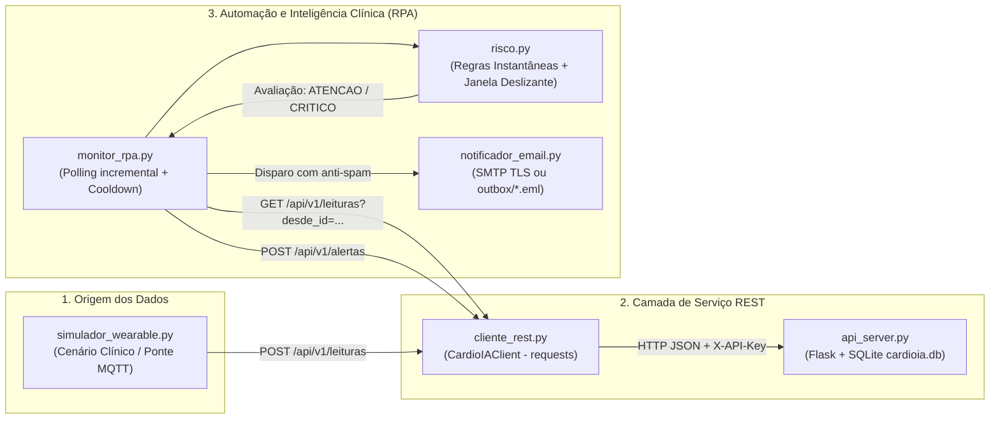

# Relatório Técnico — Ir Além 1: Comunicação Automatizada com REST, Detecção de Risco e E-mail (RPA)

**Projeto:** CardioIA — A Nova Era da Cardiologia Inteligente (Fase 3: Monitoramento Contínuo – IoT na Saúde)  
**Aluno:** Cauã Santos — **RM:** 566599  
**Curso:** Inteligência Artificial — FIAP  

---

## 1. Objetivo e Arquitetura do Subsistema

O desafio **Ir Além 1** expande o monitoramento contínuo do **CardioIA** conectando o fluxo de sinais vitais a uma arquitetura baseada em **API REST (HTTP/JSON)** e **Robotic Process Automation (RPA)** em Python. O objetivo é permitir que leituras enviadas pelo wearable (ou pela ponte MQTT $\rightarrow$ REST) sejam persistidas de forma estruturada, auditadas por um motor clínico temporal e, diante de qualquer condição de risco, acionem automaticamente o envio de um **e-mail formatado para a equipe médica de plantão**.

A solução foi organizada de forma modular na pasta [`Fase3/ir_alem_1/`](../ir_alem_1/):

| Arquivo | Responsabilidade Técnica |
| :--- | :--- |
| [`config.py`](../ir_alem_1/config.py) | Carregamento seguro de variáveis de ambiente / `.env` (sem credenciais *hardcoded*). |
| [`api_server.py`](../ir_alem_1/api_server.py) | Servidor REST em **Flask** com persistência transacional em **SQLite** (`leituras` e `alertas`) e autenticação via cabeçalho `X-API-Key`. |
| [`cliente_rest.py`](../ir_alem_1/cliente_rest.py) | Cliente HTTP (`CardioIAClient`) construído sobre `requests.Session` para envio individual/em lote (`POST`) e consumo de leituras, resumos e alertas (`GET`). |
| [`risco.py`](../ir_alem_1/risco.py) | Motor de verificação de risco com validação física de payload, regras instantâneas e regras temporais em janela deslizante. |
| [`notificador_email.py`](../ir_alem_1/notificador_email.py) | Gerador e despachante de e-mails **MIME Multipart** (`text/plain` + `text/html`), operando via **SMTP/STARTTLS** real ou gravação auditável `.eml` em `outbox/`. |
| [`monitor_rpa.py`](../ir_alem_1/monitor_rpa.py) | Robô RPA que consome novas leituras da API, avalia a janela histórica de cada paciente, aplica *cooldown* anti-spam e dispara e-mails + registros de alerta. |
| [`simulador_wearable.py`](../ir_alem_1/simulador_wearable.py) | Simulador de cenários clínicos (tempo real + lote offline do Edge) e ponte MQTT $\rightarrow$ REST a partir do broker HiveMQ. |
| [`demo_completa.py`](../ir_alem_1/demo_completa.py) | Orquestrador de teste ponta a ponta que sobe a API, envia 16 leituras, roda o RPA, valida os alertas e gera os arquivos `.eml`. |

---

## 2. Especificação da API REST e do Cliente Python

Todos os endpoints (exceto `/health`) exigem o cabeçalho `X-API-Key` e validam faixas fisiológicas plausíveis ($0 \le \text{bpm} \le 300$, $25 \le \text{temp} \le 45\,^\circ\text{C}$, $0 \le \text{umid} \le 100\%$) antes de gravar no banco:

| Método e Rota | Descrição | Corpo / Parâmetros | Resposta |
| :--- | :--- | :--- | :--- |
| `GET /api/v1/health` | Verificação de disponibilidade do serviço | — | `200 OK` `{"status":"ok", ...}` |
| `POST /api/v1/leituras` | Insere 1 leitura (objeto) ou um lote offline do Edge (lista) | JSON da leitura ou lista de leituras | `201 Created` `{"criadas":[1,2,...]}` |
| `GET /api/v1/leituras` | Consumo incremental de leituras pelo robô RPA | `?paciente=&desde_id=0&limite=200` | `200 OK` `{"leituras":[...], "total":N}` |
| `GET /api/v1/pacientes/<id>/ultima` | Última leitura + avaliação de risco nas últimas 10 amostras | `<id>` do paciente (ex.: `PAC-0001`) | `200 OK` `{"leitura":{...}, "avaliacao":{...}}` |
| `GET /api/v1/pacientes/<id>/resumo` | Estatísticas consolidadas (médias, mínimos, máximos e total de alertas) | `<id>` do paciente | `200 OK` `{"leituras":16, "alertas":7, ...}` |
| `POST /api/v1/alertas` | Registra um alerta processado pelo monitor RPA | `{"paciente", "leitura_id", "nivel", "codigos", "descricao", "email_enviado"}` | `201 Created` `{"id": 1}` |
| `GET /api/v1/alertas` | Lista histórico de alertas emitidos | `?paciente=&limite=50` | `200 OK` `{"alertas":[...], "total":N}` |

---

## 3. Lógica de Verificação de Riscos Clínicos (`risco.py`)

O motor de decisão combina **regras instantâneas** (avaliadas sobre a amostra atual) e **regras de janela temporal** (avaliadas sobre as últimas $N$ amostras do paciente mantidas em memória pelo RPA):

| Camada | Código do Risco | Condição de Disparo | Nível | Significado Clínico |
| :---: | :--- | :--- | :---: | :--- |
| Instantânea | `TAQUICARDIA` | $\text{FC} > 120\text{ bpm}$ | `CRITICO` | Taquiarritmia ou resposta adrenérgica aguda. |
| Instantânea | `BRADICARDIA` | $0 < \text{FC} < 50\text{ bpm}$ | `CRITICO` | Bradicardia acentuada / bloqueio atrioventricular. |
| Instantânea | `SEM_PULSO` | $\text{FC} = 0\text{ bpm}$ ou flag `SEM_PULSO` | `CRITICO` | Possível parada cardiorrespiratória ou deslocamento do sensor. |
| Instantânea | `FEBRE` | $\text{Temp} > 38{,}0\,^\circ\text{C}$ | `CRITICO` | Estado febril agudo. |
| Instantânea | `HIPOTERMIA` | $\text{Temp} < 35{,}0\,^\circ\text{C}$ | `CRITICO` | Hipotermia / baixa perfusão periférica. |
| Combinada | `SUSPEITA_SEPSE` | $\text{Temp} > 38{,}0\,^\circ\text{C}$ **e** $\text{FC} > 90\text{ bpm}$ | `CRITICO` | Dois critérios de SIRS (*Síndrome da Resposta Inflamatória Sistêmica*). |
| Instantânea | `QUEDA` | Flag `QUEDA` do acelerômetro ($> 2{,}5\,g$) | `CRITICO` | Impacto mecânico compatível com queda da própria altura. |
| Janela ($N=3$) | `TAQUICARDIA_SUSTENTADA` | $\text{FC} > 120\text{ bpm}$ por 3 leituras seguidas | `CRITICO` | Descarta artefato pontual de movimento e confirma taquicardia persistente. |
| Janela ($N=6$) | `AUSENCIA_MOVIMENTO` | $\text{Mov} < 0{,}05\,g$ por 6 leituras com FC normal | `ATENCAO` | Imobilidade prolongada; requer verificação preventiva. |
| Janela ($N=6$) | `IMOBILIDADE_COM_FC_BAIXA` | $\text{Mov} < 0{,}05\,g$ por 6 leituras **e** $\text{FC} < 50\text{ bpm}$ | `CRITICO` | **Suspeita de síncope / perda de consciência.** |

---

## 4. Automação RPA de E-mail e Resultados do Teste Ponta a Ponta

Para evitar *alert fatigue* (fadiga de alarmes na equipe médica), o `MonitorRPA` implementa um dicionário de **cooldown por `(paciente, codigo_risco)`** (padrão de 600 s): se o paciente permanecer com `TAQUICARDIA` e `FEBRE` na leitura seguinte, o alerta é registrado no banco para auditoria, mas o e-mail repetido é suprimido; contudo, se surgir um **novo código de risco** (como `TAQUICARDIA_SUSTENTADA` na 3ª leitura consecutiva), um novo e-mail é disparado imediatamente.

Ao executar `python Fase3/ir_alem_1/demo_completa.py`, o fluxo completo processa 16 leituras (13 em tempo real + 3 de lote offline) e gera **7 alertas no SQLite** e **6 e-mails `.eml` formatados em HTML + texto na pasta `outbox/`**:

| Leitura | Sinais Vitais Recebidos | Riscos Detectados pelo Motor | Ação do RPA (E-mail) |
| :---: | :--- | :--- | :--- |
| `#003` | `128 bpm`, `38.4 °C`, `0.18 g` | `TAQUICARDIA`, `FEBRE`, `SUSPEITA_SEPSE` | **E-mail enviado** (`CRITICO`) |
| `#004` | `134 bpm`, `38.7 °C`, `0.15 g` | `TAQUICARDIA`, `FEBRE`, `SUSPEITA_SEPSE` | *Suprimido por cooldown anti-spam* |
| `#005` | `138 bpm`, `38.9 °C`, `0.12 g` | `+ TAQUICARDIA_SUSTENTADA` (3ª leitura $>120$) | **E-mail enviado** (novo código de risco) |
| `#011` | `65 bpm`, `36.5 °C`, `0.00 g` (6ª imóvel) | `AUSENCIA_MOVIMENTO` | **E-mail enviado** (`ATENCAO`) |
| `#012` | `42 bpm`, `36.2 °C`, `0.00 g` (imóvel + FC baixa) | `BRADICARDIA`, `IMOBILIDADE_COM_FC_BAIXA` | **E-mail enviado** (`CRITICO` — síncope) |
| `#013` | `96 bpm`, `36.6 °C`, `1.85 g` | `QUEDA` | **E-mail enviado** (`CRITICO`) |
| `#016` | `58 bpm`, `34.6 °C`, `0.20 g` (lote offline Edge) | `HIPOTERMIA` | **E-mail enviado** (`CRITICO`) |

