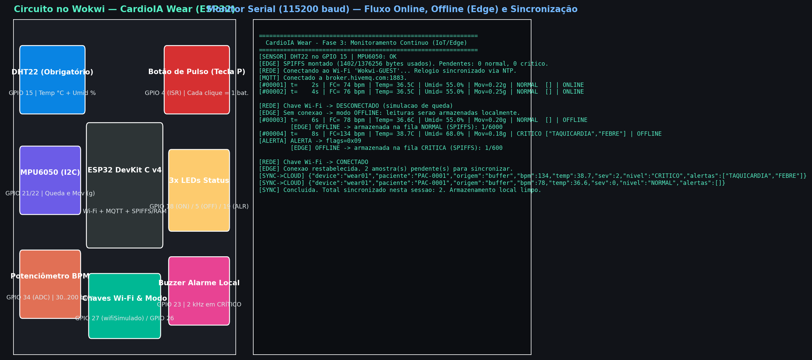
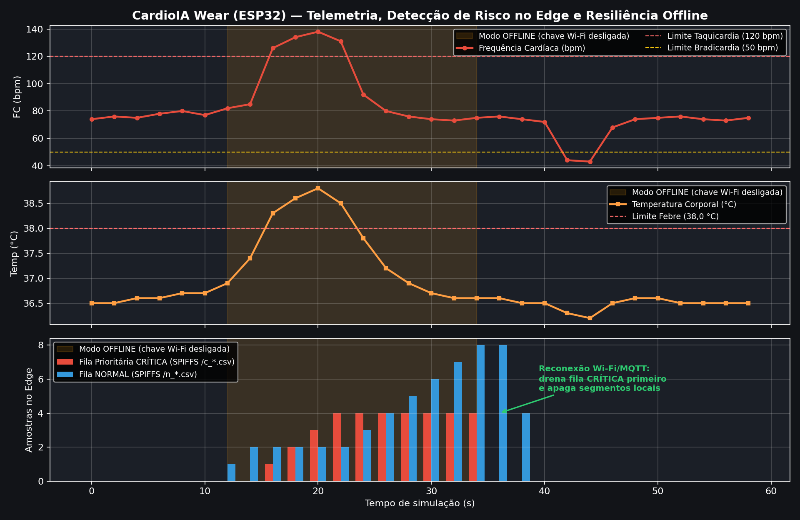

# Relatório Técnico — Parte 1: Armazenamento e Processamento Local (Edge Computing)

**Projeto:** CardioIA — A Nova Era da Cardiologia Inteligente (Fase 3: Monitoramento Contínuo – IoT na Saúde)  
**Aluno:** Cauã Santos — **RM:** 566599  
**Curso:** Inteligência Artificial — FIAP  

---

## 1. Contextualização e Continuidade do Projeto CardioIA

Nas fases anteriores do **CardioIA**, construímos a base de dados clínicos e governança (Fase 1) e os modelos diagnósticos de Processamento de Linguagem Natural, triagem supervisionada e classificação de ECG aliada ao portal web hospitalar (Fase 2). Na **Fase 3**, estendemos o ecossistema para fora do ambiente hospitalar por meio do **CardioIA Wear**: um protótipo de dispositivo vestível (*wearable*) baseado no microcontrolador **ESP32** para monitoramento contínuo de pacientes cardiológicos em regime domiciliar ou pós-alta.

Em aplicações críticas de saúde, depender exclusivamente da conectividade com a nuvem para processar sinais vitais e acionar alarmes representa um risco inaceitável: quedas de Wi-Fi, instabilidades de roteadores domésticos ou deslocamentos do paciente interromperiam a vigilância clínica. Por isso, a **Parte 1** implementa **Edge Computing (Computação na Borda)** diretamente no ESP32, garantindo:
1. **Aquisição multimodal contínua** de sinais vitais e biomecânicos;
2. **Triagem clínica local em tempo real**, acionando alarmes visuais e sonoros no próprio dispositivo mesmo sem internet;
3. **Resiliência offline com fila dupla priorizada**, preservando leituras em memória não-volátil (**SPIFFS**) ou buffer circular em **RAM** durante quedas de conexão e sincronizando-as automaticamente ao reconectar.

---

## 2. Arquitetura de Hardware e Sensores no Wokwi

O circuito do **CardioIA Wear** (definido em [`diagram.json`](../esp32_wearable/diagram.json) e no código [`src/main.cpp`](../esp32_wearable/src/main.cpp)) supera o requisito mínimo de dois sensores distintos ao integrar **três subsistemas sensores** e controles interativos para simulação de cenários clínicos e de rede:

| Componente (Wokwi) | Pino ESP32 | Função Clínica e Operacional no Protótipo |
| :--- | :---: | :--- |
| **DHT22** (`dht1`) | `GPIO 15` | Sensor obrigatório: mede **temperatura corporal periférica (°C)** e **umidade relativa / sudorese (%)**, permitindo detectar febre, hipotermia e diaforese associada a eventos isquêmicos. |
| **Botão de Pressão** (`btnPulso`) | `GPIO 4` | Simulador manual de **batimentos cardíacos** (interrupção externa `FALLING` com *debounce* de 200 ms): cada clique corresponde a uma sístole, calculando a frequência cardíaca instantânea em **BPM**. |
| **Potenciômetro** (`potBpm`) | `GPIO 34` (ADC1) | Gerador automático de pulso cardíaco (30 a 200 bpm com variabilidade fisiológica de $\pm 3\%$), permitindo simular repouso, bradicardia e taquicardia de forma contínua durante demonstrações. |
| **MPU6050** (`imu1` - I2C) | `GPIO 21` (SDA) / `22` (SCL) | Acelerômetro 3 eixos ($\pm 4\,g$ a 20 Hz): mede o **nível de atividade física ($g$)**, detecta **impactos compatíveis com queda ($> 2,5\,g$)** e **imobilidade prolongada**. |
| **Chave Deslizante Wi-Fi** (`swWifi`) | `GPIO 27` | Controla a variável booleana `wifiSimulado` exigida no enunciado: `HIGH` = conectado à nuvem; `LOW` = simula queda de Wi-Fi e força o modo de armazenamento offline no Edge. |
| **Chave Deslizante Modo** (`swModo`) | `GPIO 26` | Alterna a origem do pulso cardíaco entre `AUTO` (potenciômetro) e `MANUAL` (botão físico / tecla `P` no Wokwi). |
| **LED Verde** (`ledOnline`) | `GPIO 18` | Indicador de rede: aceso fixo quando online; piscando rápido (2 Hz) durante a sincronização do backlog offline. |
| **LED Amarelo** (`ledOffline`) | `GPIO 5` | Indicador de Edge Computing: aceso quando o dispositivo opera offline gravando leituras localmente. |
| **LED Vermelho + Buzzer** | `GPIO 19` / `GPIO 23` | Alerta clínico local: aceso fixo em nível `ATENCAO`; piscando com alarme sonoro de 2 kHz em nível `CRITICO` (funciona mesmo sem Wi-Fi). |

### 2.1. Link Oficial do Projeto no Wokwi e Como Executar

* **Link Direto no Wokwi Web:** [**https://wokwi.com/projects/479801389695851521**](https://wokwi.com/projects/479801389695851521)
* **Opção A — Wokwi Web (Navegador):** acesse diretamente o link acima ([`https://wokwi.com/projects/479801389695851521`](https://wokwi.com/projects/479801389695851521)) e clique no botão verde **Start the simulation**.
* **Opção B — VS Code (Wokwi Extension + PlatformIO):** abra a pasta [`Fase3/esp32_wearable/`](../esp32_wearable/), onde o firmware já está compilado em `.pio/build/esp32dev/firmware.bin`, pressione `F1` e selecione **`Wokwi: Start Simulator`**.



---

## 3. Fluxo de Funcionamento e Processamento Local (Edge)

O laço principal (`loop()`) é totalmente **não-bloqueante** (baseado em `millis()`), garantindo que a leitura do acelerômetro, a contagem de batimentos por interrupção e a sincronização de rede ocorram em paralelo sem perda de amostras:

```mermaid
flowchart TD
    A["Aquisição Multimodal<br/>• ISR Botão / Potenciômetro (BPM)<br/>• DHT22 (Temp °C e Umidade %)<br/>• MPU6050 I2C 20 Hz (Movimento e Pico g)"] --> B["Processamento Clínico no Edge<br/>coletarAmostra() a cada 2 s"]
    B --> C{"Avaliação de Limiares Locais<br/>Flags de Risco (Bitmask 8 bits)"}
    C -->|Sem anomalias| D["Severidade: NORMAL (0)<br/>LED Alerta apagado"]
    C -->|Imobilidade / Falha Sensor| E["Severidade: ATENCAO (1)<br/>LED Vermelho fixo"]
    C -->|FC > 120 ou < 50 bpm, Sem Pulso,<br/>Temp > 38 ou < 35 °C, Queda > 2.5g| F["Severidade: CRITICO (2)<br/>LED Vermelho piscando + Buzzer 2 kHz"]
    D & E & F --> G{"Conectividade Ativa?<br/>wifiSimulado == true<br/>&& Wi-Fi OK && MQTT OK"}
    G -->|SIM (Online)| H["Publica ao vivo em /telemetria<br/>+ Envia evento em /alerta (se crítico)"]
    G -->|NÃO (Offline)| I["Armazenamento Local (Edge)<br/>Crítico -> Fila Prioritária (bufCritico)<br/>Normal/Atenção -> Fila Normal (bufNormal)"]
    H --> J{"Há backlog pendente<br/>no armazenamento local?"}
    J -->|SIM| K["sincronizarBacklog() em lotes de 20<br/>1º Drena Fila Crítica, 2º Fila Normal<br/>Serial.println('[SYNC->CLOUD] ...') + MQTT /backlog<br/>Apaga registro/arquivo local após envio OK"]
    J -->|NÃO| L["Próximo ciclo (loop)"]
    K --> L
    I --> L
```

### 3.1. Cálculo de BPM e Regras Clínicas Embarcadas

1. **Frequência Cardíaca (BPM):** a rotina de interrupção `isrBatimento()` registra os *timestamps* (`millis()`) dos últimos 8 batimentos em um vetor circular protegido por *spinlock* (`portMUX_TYPE beatMux`). A função `calcularBpm()` calcula a média dos intervalos R-R recentes ($60.000 / \overline{\Delta t}_{\text{ms}}$). Se o intervalo desde o último pulso superar $1{,}5\times$ a média recente, o algoritmo adota imediatamente o intervalo atual — permitindo detectar bradicardia súbita sem atraso de média móvel. Após `6 s` sem pulsos, retorna `0 bpm` (`F_SEM_PULSO`).
2. **Biomecânica e Queda (MPU6050):** a cada `50 ms` (20 Hz), o firmware lê os registradores `0x3B..0x40` via I2C, calcula o módulo do vetor aceleração $\|\vec{a}\| = \sqrt{a_x^2 + a_y^2 + a_z^2}$ e o desvio dinâmico $|\|\vec{a}\| - 1{,}0\,g|$. Picos acima de $2{,}5\,g$ acionam `F_QUEDA`; ausência de desvio $> 0{,}08\,g$ por `60 s` aciona `F_IMOBILIDADE`.
3. **Classificação Local por Bitmask:** cada leitura recebe um byte `flags` combinando até 8 condições (`TAQUICARDIA > 120 bpm`, `BRADICARDIA < 50 bpm`, `SEM_PULSO`, `FEBRE > 38,0 °C`, `HIPOTERMIA < 35,0 °C`, `QUEDA`, `IMOBILIDADE`, `FALHA_SENSOR`), classificando a amostra em `NORMAL (0)`, `ATENCAO (1)` ou `CRITICO (2)`.

---

## 4. Estratégia de Resiliência Offline e Dimensionamento de Negócio

### 4.1. Alinhamento com o Modelo de Negócio do CardioIA

No modelo de negócio do **CardioIA**, o paciente cardiológico monitorado em domicílio utiliza o wearable continuamente, mas pode ficar desconectado do gateway (smartphone ou roteador Wi-Fi residencial) durante o **período completo de sono noturno (8 horas)** ou em deslocamentos urbanos.
* Em regime de produção clínica, a taxa de amostragem padrão é de **1 leitura a cada 5 segundos** ($720\text{ amostras/hora}$).
* Para cobrir **8 horas contínuas offline** sem perda de histórico fisiológico:
  $$N_{\text{amostras}} = 8\text{ h} \times 720\text{ amostras/h} = 5.760\text{ amostras}$$
* Adotamos uma margem de segurança e dimensionamos a capacidade total no ESP32 para **6.600 amostras**, divididas em **duas filas independentes com prioridade clínica**:
  * **Fila Normal (`CAP_NORMAL = 6.000` amostras):** armazena leituras `NORMAL` e `ATENCAO` (~8h20 de autonomia).
  * **Fila Crítica Prioritária (`CAP_CRITICO = 600` amostras):** reservada exclusivamente para amostras com `sev == SEV_CRITICO`.

> **Por que duas filas separadas?** Em um buffer circular único, caso o paciente permanecesse muitas horas offline depois de sofrer uma arritmia curta, milhares de leituras normais subsequentes sobrescreveriam o registro do evento crítico. Com a fila crítica isolada, **leituras normais jamais expulsam alertas médicos da memória**.

### 4.2. Compactação Binária e Duplo Backend (`SPIFFS` + `RAM`)

Para armazenar 6.600 amostras dentro da memória do ESP32 com folga para as pilhas Wi-Fi e TCP/IP, cada leitura é empacotada na estrutura binária `Amostra` de apenas **12 bytes** (`__attribute__((packed))`):

```cpp
struct __attribute__((packed)) Amostra {
  uint32_t uptime_s;   // 4 bytes: segundos desde o boot (convertido para epoch UTC no envio)
  int16_t  temp_x10;   // 2 bytes: temperatura x10 (ex.: 365 = 36,5 °C)
  uint16_t umid_x10;   // 2 bytes: umidade x10 (ex.: 550 = 55,0 %)
  uint8_t  bpm;        // 1 byte : frequência cardíaca (0..255 bpm)
  uint8_t  mov_cg;     // 1 byte : movimento médio em centi-g (0..2,55 g)
  uint8_t  flags;      // 1 byte : bitmask FlagRisco (8 flags clínicas)
  uint8_t  sev;        // 1 byte : severidade (0=NORMAL, 1=ATENCAO, 2=CRITICO)
};                     // Total  : 12 bytes -> 6.600 amostras = 79.200 bytes (~77,3 KB)
```

Como destacado no enunciado, o sistema de arquivos **SPIFFS** é persistente em chips ESP32 físicos, mas volátil nos simuladores. Por isso, projetamos a interface abstrata `BufferAmostras` com duas implementações intercambiáveis:
1. **`SpiffsSegmentBuffer` (Persistente em Flash — Chip Real):** grava as amostras em arquivos CSV segmentados (`/n_000000.csv` a `/n_000011.csv` com 500 linhas cada para a fila normal, e `/c_000000.csv` a `/c_000005.csv` com 100 linhas cada para a fila crítica). Ao atingir o limite de segmentos, aplica *log rotation* removendo o segmento mais antigo. No `begin()`, reconstrói o estado da fila varrendo o diretório raiz da Flash, sobrevivendo a quedas de bateria.
2. **`RamRingBuffer` (Fallback Automático — Simulador):** caso o SPIFFS não esteja disponível, aloca os buffers circulares em RAM (`malloc`), mantendo exatamente a mesma semântica FIFO com sobrescrita da amostra mais antiga quando cheio e contabilização de descartes (`dropped()`).

### 4.3. Sincronização ao Reconectar e Limpeza do Armazenamento Local

Quando a chave `swWifi` retorna para `HIGH` (`wifiSimulado = true`) e a conexão Wi-Fi/MQTT é restabelecida:
1. O estado muda para `sincronizando = true` e o LED verde passa a piscar.
2. A função `sincronizarBacklog()` envia até `SYNC_BATCH = 20` registros por iteração do `loop()`, **drenando primeiro toda a `bufCritico` e depois a `bufNormal`**.
3. Para cada amostra recuperada via `peek()`, o firmware monta o JSON com `"origem":"buffer"`, publica no tópico MQTT `/backlog` e imprime no Monitor Serial a linha `[SYNC->CLOUD] {...}` via `Serial.println` — cumprindo simultaneamente a exigência de envio via Serial no simulador e via MQTT na nuvem.
4. Somente após a confirmação de envio (`mqtt.publish(...) == true`), o método `pop()` é chamado. Quando todas as linhas de um segmento CSV foram enviadas, o arquivo é **fisicamente removido do SPIFFS** com `SPIFFS.remove(caminho(head_))`. Ao zerar ambas as filas, o ESP32 emite um evento consolidado `ALERTA_RETROATIVO` caso tenham ocorrido amostras críticas durante o período offline.



