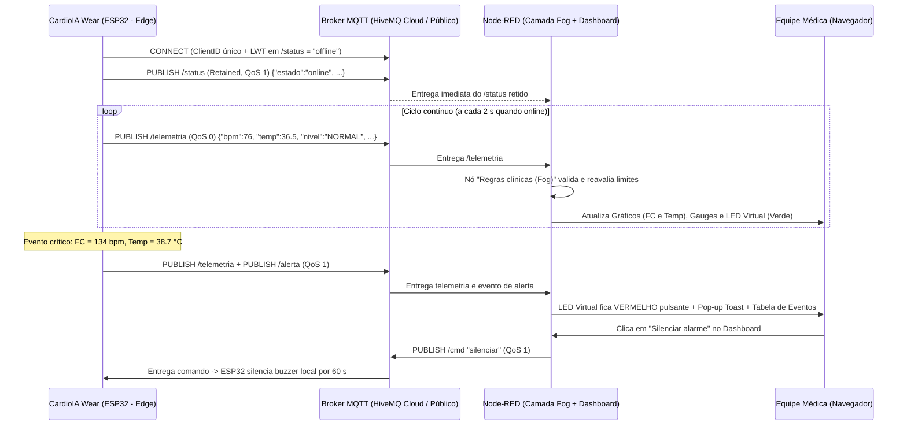
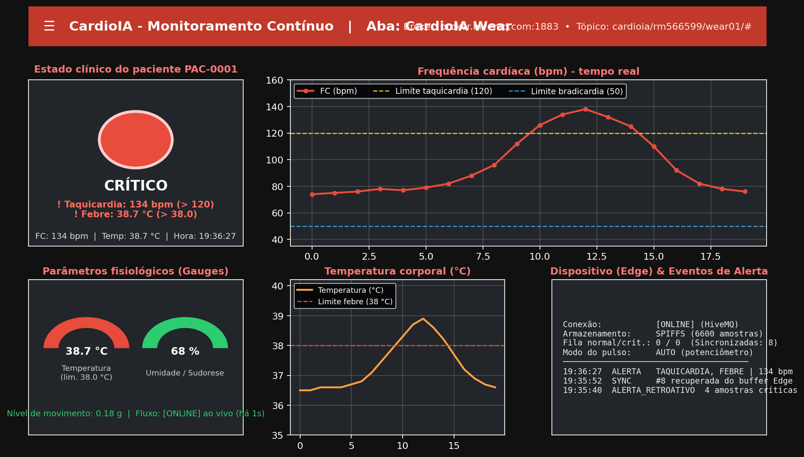

# Relatório Técnico — Parte 2: Transmissão para Nuvem e Visualização (Fog/Cloud Computing)

**Projeto:** CardioIA — A Nova Era da Cardiologia Inteligente (Fase 3: Monitoramento Contínuo – IoT na Saúde)  
**Aluno:** Cauã Santos — **RM:** 566599  
**Curso:** Inteligência Artificial — FIAP  

---

## 1. Visão Geral da Arquitetura Edge – Fog – Cloud

Na **Parte 2**, integramos o wearable **CardioIA Wear (ESP32)** a uma arquitetura distribuída em três camadas para telemonitoramento cardiológico em tempo real:

1. **Camada Edge (ESP32 no Paciente):** captura continuamente temperatura/umidade (DHT22), frequência cardíaca (botão de pulso / gerador automático) e aceleração (MPU6050), executa a primeira triagem clínica local, garante resiliência offline (SPIFFS/RAM) e publica os dados serializados em JSON.
2. **Camada Cloud Broker (HiveMQ MQTT):** atua como barramento de mensageria assíncrono publish/subscribe de baixa latência, desacoplando os dispositivos vestíveis dos sistemas hospitalares e gerenciando retenção de estado (*Retained Messages*) e detecção de desconexão abrupta (*Last Will and Testament — LWT*).
3. **Camada Fog / Aplicação Clínica (Node-RED Dashboard):** recebe os fluxos MQTT em tempo real, realiza uma **segunda validação independente das regras clínicas** (auditoria cruzada Edge $\times$ Fog), exibe gráficos temporais, medidores (*gauges*), indicador visual de alerta (LED virtual animado + *pop-ups* sonoros/visuais), histórico de eventos de sincronização e envia comandos remotos de volta ao ESP32.



---

## 2. Protocolo MQTT, Hierarquia de Tópicos e Contratos JSON

### 2.1. Configuração do Broker HiveMQ

O firmware do ESP32 ([`src/main.cpp`](../esp32_wearable/src/main.cpp)) suporta nativamente dois modos de conexão ao broker HiveMQ, selecionáveis pela diretiva `MQTT_USE_TLS`:
* **Modo Padrão de Demonstração (`MQTT_USE_TLS = 0`):** conecta-se ao broker público `broker.hivemq.com` na porta TCP `1883`, permitindo que o avaliador execute o projeto no Wokwi e no Node-RED imediatamente sem necessidade de criar conta ou configurar credenciais.
* **Modo Produção / Cluster Privado (`MQTT_USE_TLS = 1`):** utiliza `WiFiClientSecure` na porta `8883` (MQTT over TLS) com autenticação de usuário e senha em um cluster **HiveMQ Cloud** (`*.s1.eu.hivemq.cloud`).

### 2.2. Estrutura de Tópicos e Políticas de QoS

Adotamos o namespace hierárquico `cardioia/rm566599/<device_id>/<canal>`, permitindo escalar a solução para múltiplos pacientes e dispositivos usando *wildcards* (`cardioia/rm566599/+/telemetria`):

| Tópico MQTT | Direção | QoS | Retained | Finalidade e Justificativa Técnica |
| :--- | :---: | :---: | :---: | :--- |
| `cardioia/rm566599/wear01/telemetria` | ESP32 $\rightarrow$ Fog | `0` | Não | Fluxo contínuo ao vivo (a cada 2 s). Usa QoS 0 para minimizar latência e consumo de rádio; se um pacote colidir, o próximo chega 2 s depois. |
| `cardioia/rm566599/wear01/backlog` | ESP32 $\rightarrow$ Fog | `0` | Não | Drenagem das leituras armazenadas offline no SPIFFS/RAM após reconexão (`"origem":"buffer"`), preservando o timestamp original da coleta. |
| `cardioia/rm566599/wear01/alerta` | ESP32 $\rightarrow$ Fog | `1` | Não | Disparo imediato na entrada em estado crítico (`ALERTA`), lembrete a cada 60 s (`ALERTA_PERSISTENTE`), retorno ao normal (`NORMALIZADO`) e resumo pós-offline (`ALERTA_RETROATIVO`). |
| `cardioia/rm566599/wear01/status` | ESP32 $\rightarrow$ Fog | `1` | **Sim** | Telemetria de saúde do próprio dispositivo (estado da rede, ocupação das filas SPIFFS/RAM, RSSI, uptime). Configurado também como **LWT** (*Last Will*): se a bateria acabar abruptamente, o broker publica `{"estado":"offline","motivo":"lwt"}`. |
| `cardioia/rm566599/wear01/cmd` | Fog $\rightarrow$ ESP32 | `1` | Não | Canal bidirecional de atuação remota: recebe comandos do dashboard (`silenciar` para mutar o buzzer por 60 s; `status` para forçar atualização imediata). |

### 2.3. Exemplos de Payloads JSON

**1. Telemetria / Backlog (`/telemetria` e `/backlog`):**
```json
{
  "device": "wear01",
  "paciente": "PAC-0001",
  "origem": "live",
  "ts": 1793830587,
  "uptime_s": 142,
  "bpm": 134,
  "temp": 38.7,
  "umid": 68.0,
  "mov": 0.18,
  "sev": 2,
  "nivel": "CRITICO",
  "alertas": ["TAQUICARDIA", "FEBRE"],
  "flags": 9
}
```

**2. Status do Dispositivo e Resiliência (`/status`):**
```json
{
  "device": "wear01",
  "estado": "online",
  "backend": "SPIFFS",
  "buffer_normal": 0,
  "buffer_critico": 0,
  "capacidade": 6600,
  "descartadas": 0,
  "sincronizadas": 8,
  "modo": "AUTO",
  "rssi": -58,
  "uptime_s": 142
}
```

---

## 3. Configuração e Arquitetura do Dashboard no Node-RED

O fluxo completo do Node-RED está exportado em [`Fase3/node-red/cardioia_dashboard_flow.json`](../node-red/cardioia_dashboard_flow.json) (34 nós distribuídos em 5 seções funcionais) e utiliza a biblioteca oficial **`node-red-dashboard`**.

### 3.1. Processamento na Camada Fog (`fn_fog` — "Regras clínicas (Fog)")

Ao receber cada JSON de `cardioia/rm566599/wear01/telemetria`, o nó de função **Regras clínicas (Fog)** executa:
1. **Validação estrutural:** descarta payloads malformados ou sem `bpm` numérico;
2. **Reavaliação independente dos limites clínicos definidos pelo grupo:**
   * **Taquicardia:** $\text{FC} > 120\text{ bpm}$ $\rightarrow$ `CRITICO`
   * **Bradicardia:** $0 < \text{FC} < 50\text{ bpm}$ $\rightarrow$ `CRITICO`
   * **Ausência de pulso:** `SEM_PULSO` (`FC == 0` fora da janela de carência) $\rightarrow$ `CRITICO`
   * **Febre:** $\text{Temperatura} > 38{,}0\,^\circ\text{C}$ $\rightarrow$ `CRITICO`
   * **Hipotermia:** $\text{Temperatura} < 35{,}0\,^\circ\text{C}$ $\rightarrow$ `CRITICO`
   * **Queda biomecânica:** pico de aceleração $> 2{,}5\,g$ (`QUEDA`) $\rightarrow$ `CRITICO`
   * **Imobilidade / Falha de sensor:** $\rightarrow$ `ATENCAO`
3. **Auditoria Edge $\times$ Fog:** compara o nível calculado no Node-RED com o campo `nivel` enviado pelo ESP32, registrando aviso caso haja divergência;
4. **Roteamento multi-saída (7 saídas simultâneas):** alimenta os dois gráficos com linhas de referência dos limites clínicos, os três *gauges*, o LED virtual de alerta e o *pop-up* de notificação (`ui_toast`) acionado apenas na transição para `CRITICO`.

### 3.2. Componentes Visuais do Dashboard

| Grupo no Dashboard | Widget Node-RED | Parâmetro Exibido e Comportamento |
| :--- | :--- | :--- |
| **1. Estado clínico do paciente PAC-0001** | `ui_template` (`tpl_led`) + `ui_toast` | **Indicador visual de alerta (LED virtual + texto):** exibe um LED circular com brilho CSS que fica **verde** (`NORMAL`), **amarelo** (`ATENCAO`) ou **vermelho pulsante** (`CRITICO`), acompanhado da lista de alertas ativos (`⚠ Taquicardia: 134 bpm (> 120)`, `⚠ Febre: 38.7 °C (> 38.0)`) e resumo instantâneo de FC, temperatura e horário. |
| **2. Frequência cardíaca (tempo real)** | `ui_chart` (`chart_fc`) | **Gráfico de linha em tempo real (últimos 5 min):** plota a série histórica de FC (30 a 200 bpm) junto com duas linhas tracejadas horizontais fixas nos limites de **120 bpm (taquicardia)** e **50 bpm (bradicardia)**. |
| **3. Parâmetros fisiológicos** | 3 $\times$ `ui_gauge` (`gauge_temp`, `gauge_umid`, `gauge_mov`) | **Medidores (*gauges*):**<br>• **Temperatura (°C):** tipo *gage* (34 a 42 °C) com faixas de cor azul ($<35^\circ\text{C}$), verde ($35\text{–}38^\circ\text{C}$) e vermelha ($>38^\circ\text{C}$);<br>• **Umidade / Sudorese (%):** tipo *donut* (0 a 100%);<br>• **Nível de Movimento ($g$):** tipo *wave* (0 a $2{,}5\,g$). |
| **4. Temperatura corporal (tempo real)** | `ui_chart` (`chart_temp`) | **Gráfico de linha em tempo real:** evolução térmica do paciente comparada à linha limite de febre ($38{,}0\,^\circ\text{C}$). |
| **5. Dispositivo & resiliência (Edge)** | `ui_text` (`Watchdog`) + `ui_template` (`tpl_status`) + 2 $\times$ `ui_button` | Exibe o *watchdog* de fluxo (`🟢 ao vivo (há 1s)` ou alerta de falta de dados), tabela de diagnóstico do ESP32 (backend `SPIFFS`/`RAM`, ocupação das filas normal e crítica, total sincronizado, RSSI, uptime) e botões **`Silenciar alarme`** e **`Atualizar status`**. |
| **6. Eventos de alerta & sincronização** | `ui_template` (`tpl_eventos`) + `ui_toast` | Tabela cronológica unificando eventos de `/alerta` (`ALERTA`, `NORMALIZADO`, `ALERTA_RETROATIVO`) e amostras recuperadas de `/backlog` (`SYNC`), com contador de leituras resgatadas do Edge. |



### 3.3. Passo a Passo para Importar e Executar o Dashboard

1. Instale e inicie o Node-RED com o pacote de dashboard:
   ```bash
   npm install -g --unsafe-perm node-red node-red-dashboard
   node-red
   ```
2. Acesse `http://127.0.0.1:1880`, abra o menu **☰ $\rightarrow$ Import**, selecione o arquivo [`Fase3/node-red/cardioia_dashboard_flow.json`](../node-red/cardioia_dashboard_flow.json) e clique em **Deploy**.
3. Abra o dashboard em **`http://127.0.0.1:1880/ui`**.
4. Inicie a simulação no **Wokwi** (ou execute `python Fase3/node-red/simulador_mqtt.py` para publicar telemetria e alertas reais no broker `broker.hivemq.com`).

---

## 4. Eficiência, Segurança e Boas Práticas em IoT Médico

1. **Privacidade e Conformidade com a LGPD (Lei nº 13.709/2018):** dados de sinais vitais são classificados como **dados pessoais sensíveis de saúde (Art. 5º, II e Art. 11)**. No CardioIA Wear, aplicamos **pseudonimização na origem (Privacy by Design)**: o firmware jamais armazena ou transmite nome, CPF ou endereço do paciente, utilizando exclusivamente o identificador pseudonimizado `PAC-0001`. A associação entre `PAC-0001` e o cadastro civil permanece restrita ao banco de dados hospitalar autenticado.
2. **Segurança na Camada de Transporte e Acesso:** para implantação em produção, a flag `MQTT_USE_TLS = 1` habilita criptografia **TLS 1.2/1.3** na porta `8883` com autenticação por credenciais dedicadas por dispositivo e controle de acesso por lista (ACL) no broker, impedindo interceptação (*man-in-the-middle*) ou injeção de comandos falsos no tópico `/cmd`.
3. **Confiabilidade de Alarmes Clínicos (IEC 60601-1-8):** seguindo as diretrizes internacionais para sistemas de alarme em equipamentos eletromédicos:
   * Os alarmes são classificados por prioridade (`NORMAL`, `ATENCAO`, `CRITICO`) com codificação visual e sonora distinta;
   * O comando remoto `silenciar` aplica **pausa temporária (*audio paused*) de 60 segundos** apenas no buzzer sonoro, mantendo o LED vermelho piscando e o alerta ativo no dashboard até que os sinais vitais retornem à faixa fisiológica;
   * O mecanismo de **Watchdog + LWT** garante que a equipe médica jamais confunda um "dispositivo desligado/sem rede" com um "paciente estável".

