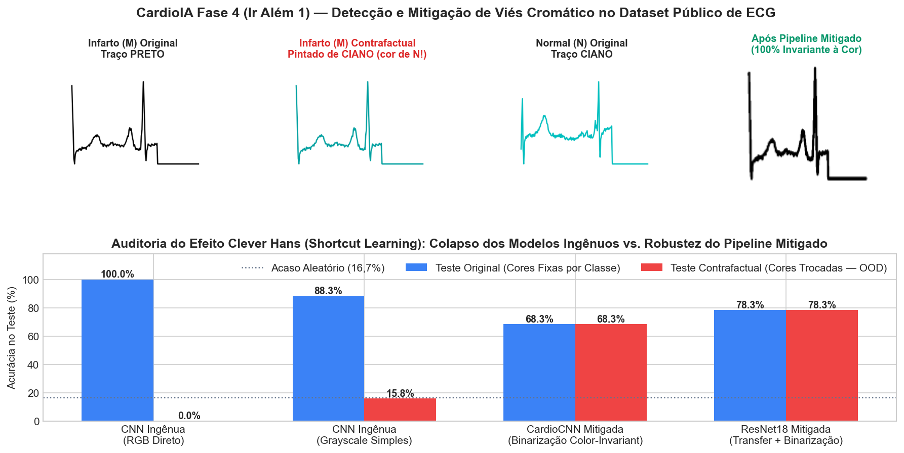
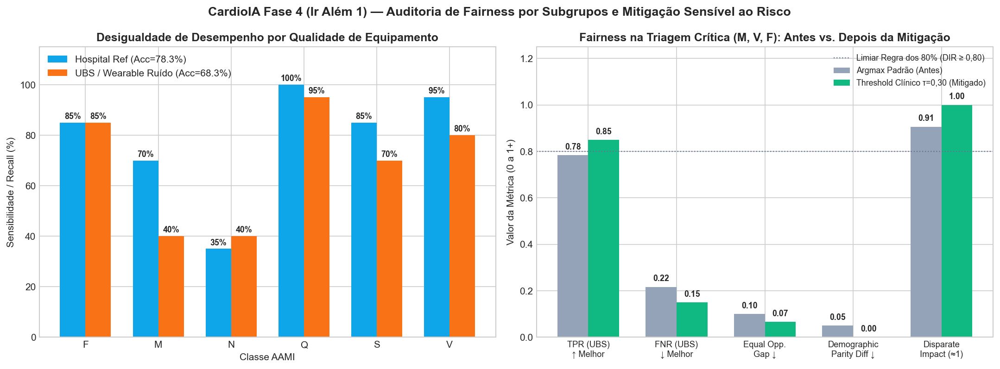

# Relatório Técnico — Ir Além 1: Ética, Vieses e Governança em Visão Computacional

**Projeto:** CardioIA — Fase 4 | **Aluno:** Cauã Santos — **RM:** 566599  
**Notebook de Fairness:** [`03_etica_governanca_fairness.ipynb`](../notebooks/03_etica_governanca_fairness.ipynb) | **Código e JSON:** [`auditoria_fairness.py`](../src/auditoria_fairness.py) · [`fairness_audit.json`](../data/processed/fairness_audit.json)

---

## 1. Limitações e Vieses Identificados no Dataset Público de ECG

A auditoria técnica sobre o **ECG Image Data (MIT-BIH / AAMI — 420 imagens, 6 classes)** revelou quatro limitações críticas:
1. **Viés de Atalho Cromático (*Shortcut Learning / Efeito Clever Hans*):** cada classe foi originalmente renderizada com uma cor fixa exclusiva (`F`=Azul, `M`=Preto, `N`=Ciano, `Q`=Amarelo, `S`=Vermelho, `V`=Verde). Mesmo em escala de cinza simples, persistem luminâncias distintas (`0,0` a `169,2`), levando redes ingênuas a decorar a cor em vez da morfologia cardíaca.
2. **Ausência de Metadados Demográficos e Representatividade Restrita:** as imagens não trazem idade, sexo, raça/etnia ou modelo do eletrocardiógrafo, inviabilizando auditoria demográfica direta (ex.: sintomas e padrões isquêmicos atípicos em mulheres e idosos). Além disso, o MIT-BIH provém de apenas 47 pacientes dos EUA (anos 1970), configurando viés populacional e histórico frente ao SUS.
3. **Desbalanceamento Epidemiológico Mascarado:** o recorte possui 70 imagens/classe (16,7% cada), enquanto na clínica real batimentos normais (`N`) superam 82% e fusões (`F`) representam <1%. Sem recalibração, isso pode elevar falsos positivos (*fadiga de alarmes*) em produção.
4. **Escopo Clínico Reduzido:** recortes de 1 único batimento em 1 derivação, sem ruído real de atenção primária (UBS) ou *wearables*, dificultam distinguir isquemia sem supra (`M`) de batimento normal (`N`).

---

## 2. Experimento 1 — Prova Quantitativa do Efeito *Clever Hans* e Mitigação 1

Treinamos CNNs ingênuas (RGB direto e Grayscale simples) e submetemos os modelos a um **Teste Contrafactual de Troca de Cores (*Color Swap — OOD*)** no conjunto de teste (`n=120`, ex.: Infarto `M` pintado de Ciano):

| Modelo / Pipeline | Teste Original | Color Swap (OOD) | Queda (p.p.) | Diagnóstico Ético |
| :--- | :---: | :---: | :---: | :--- |
| **CNN Ingênua (RGB Direto)** | 100,00% | **0,00%** | **-100,00 pp** | Aprendeu 100% cor, 0% morfologia |
| **CNN Ingênua (Grayscale Simples)** | 88,33% | **15,83%** | **-72,50 pp** | Colapso ao acaso (16,7%) via luminância |
| **CardioCNN Mitigada (Color-Invariant)** | 68,33% | **68,33%** | **0,00 pp** | Imune ao viés cromático |
| **ResNet18 Mitigada (Transfer + Binarização)** | **78,33%** | **78,33%** | **0,00 pp** | Melhor acurácia + invariância total |

---

## 3. Experimentos 2 e 3 — Métricas de Fairness por Subgrupo e Mitigação 2

Avaliamos a equidade sociotécnica da `ResNet18` entre **Hospital de Referência (`Hospital_Ref`, $n=120$)** e **Unidade Básica / Wearable com Ruído (`UBS_Ruido`, $n=120$)**. Antes da mitigação, a acurácia caiu de `78,33%` para `68,33%` na UBS (com queda no Recall de Infarto `M` de `70%` para `40%`) e a Taxa de Falsos Negativos (`FNR`) na triagem crítica (`M, V, F`) atingiu `21,67%` (vs. `11,67%` no hospital).

Como **Mitigação 2**, aplicamos **Calibração de Limiar Clínico ($\tau = 0{,}30$)** sobre a probabilidade crítica acumulada $P(M)+P(V)+P(F)$, priorizando sensibilidade onde o erro de omissão é letal:

| Métrica de Fairness (Triagem Crítica M/V/F) | Argmax Padrão (Antes) | Limiar $\tau=0{,}30$ (Mitigado) | Impacto |
| :--- | :---: | :---: | :--- |
| **TPR / Sensibilidade (`UBS_Ruido`) ↑** | 78,33% | **85,00%** | **+6,67 pp** na ponta desfavorecida |
| **FNR / Falsos Negativos (`UBS_Ruido`) ↓** | 21,67% (13 FN) | **15,00% (9 FN)** | **-30,8% menos FN críticos** |
| **Equal Opportunity Difference ($|\text{TPR}_A - \text{TPR}_B|$) ↓** | 0,1000 | **0,0667** | **-33,3% de disparidade** |
| **Demographic Parity Difference ↓** | 0,0500 | **0,0000** | Paridade demográfica exata |
| **Disparate Impact Ratio ($\ge 0{,}80$) ↑** | 0,9062 | **1,0000** | Equidade plena (Regra dos 80%) |

---

## 4. Implicações Éticas e Diretrizes de Governança Clínica

1. **Apoio à Decisão (*Human-in-the-Loop*):** toda predição apresenta mapa **Grad-CAM**, probabilidades completas e aviso explícito de que o modelo **não substitui o laudo cardiológico**.
2. **Dados Sensíveis e LGPD (Lei 13.709/2018):** exames médicos exigem anonimização na origem, pseudonimização (`PAC-0001`), tráfego criptografado (TLS) e retenção mínima.
3. **Validação Multicêntrica e ANVISA (RDC 657/2022 — SaMD):** antes de qualquer uso clínico real, é indispensável expandir o treino para ECGs de 12 derivações com metadados demográficos brasileiros (ex.: rede de telessaúde do SUS) e monitorar continuamente *data drift* por equipamento e subgrupo populacional.
