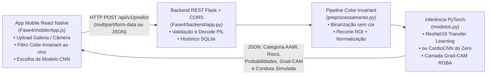

# Relatório Técnico — Ir Além 2: Integração com Aplicativo Mobile em React Native

**Projeto:** CardioIA — A Nova Era da Cardiologia Inteligente (Fase 4: Assistente Cardiológico Virtual com Visão Computacional)  
**Aluno:** Cauã Santos — **RM:** 566599  
**Backend Flask:** [`Fase4/backend/app.py`](../backend/app.py)  
**Aplicativo Mobile React Native (Expo):** [`Fase4/mobile/App.js`](../mobile/App.js)

---

## 1. Arquitetura Ponta a Ponta (Mobile React Native ↔ API Flask ↔ CNN/ResNet18)

O módulo **Ir Além 2** disponibiliza os modelos de Visão Computacional treinados na Fase 4 em um aplicativo mobile multiplataforma (**Android, iOS e Web** via **React Native + Expo**), integrado em tempo real a um servidor REST em **Python/Flask**:



---

## 2. Contrato da API REST em Flask (`Fase4/backend/app.py`)

O servidor Flask habilita **CORS** (`flask-cors`), serve a interface web interativa em `GET /` e expõe os endpoints consumidos pelo aplicativo React Native:

| Método | Rota | Descrição |
| :---: | :--- | :--- |
| `GET` | `/api/v1/health` | Status da API, modelos carregados (`resnet18_transfer`, `cnn_scratch`), métricas de teste e dicionário clínico das 6 classes AAMI. |
| `GET` | `/api/v1/samples` | Retorna exames reais do conjunto de teste com miniatura em base64 para avaliação rápida no app. |
| `POST` | `/api/v1/preview-filter` | Aplica o filtro *Color-Invariant* em tempo real para pré-visualização da neutralização cromática antes da inferência. |
| `POST` | `/api/v1/predict` | Recebe imagem via `multipart/form-data` (`image`), `image_base64` ou `sample_id`; executa pré-processamento, inferência CNN, gera **Grad-CAM RGBA**, grava no SQLite e retorna o diagnóstico estruturado. |
| `GET` | `/api/v1/history` | Lista as últimas análises persistidas em `Fase4/backend/data/cardioia_vision.db`. |

---

## 3. Organização de Código e Componentes React Native (`Fase4/mobile/`)

* [`App.js`](../mobile/App.js): interface principal em três abas (**Analisar ECG**, **Amostras** e **Histórico**), alternância entre **Tema Claro Clínico** e **Modo Escuro UTI**, seletor de endpoint Flask (`⚙`) e switch de pré-visualização *Color-Invariant*.
* [`src/theme.js`](../mobile/src/theme.js): tokens visuais hospitalares para modo claro e escuro.
* [`src/services/api.js`](../mobile/src/services/api.js): cliente HTTP com suporte a `FormData` (`multipart/form-data`) para uploads de câmera e galeria via `expo-image-picker`.
* [`src/components/InteractiveGradCamViewer.js`](../mobile/src/components/InteractiveGradCamViewer.js): inspetor interativo de explicabilidade com alternância de camadas (`Grad-CAM`, `Color-Invariant`, `Original RGB`), slider tátil de opacidade (`0%–100%`), zoom `100%–300%` com rolagem 2D, modal em tela cheia e selo de cor neutralizada.
* [`src/components/RiskBadge.js`](../mobile/src/components/RiskBadge.js) e [`src/components/ProbabilityBar.js`](../mobile/src/components/ProbabilityBar.js): exibição clara da severidade clínica e das probabilidades nas 6 categorias AAMI (`F`, `M`, `N`, `Q`, `S`, `V`).

---

## 4. Como Executar Localmente

```bash
# Terminal 1 — Subir o Backend Flask (raiz do repositório CardioIA/)
python Fase4/backend/app.py

# Terminal 2 — Subir o App React Native (Expo)
cd Fase4/mobile
npm install
npm start
# Pressione 'w' (Web), 'a' (Android Emulator) ou escaneie o QR Code no app Expo Go
```
