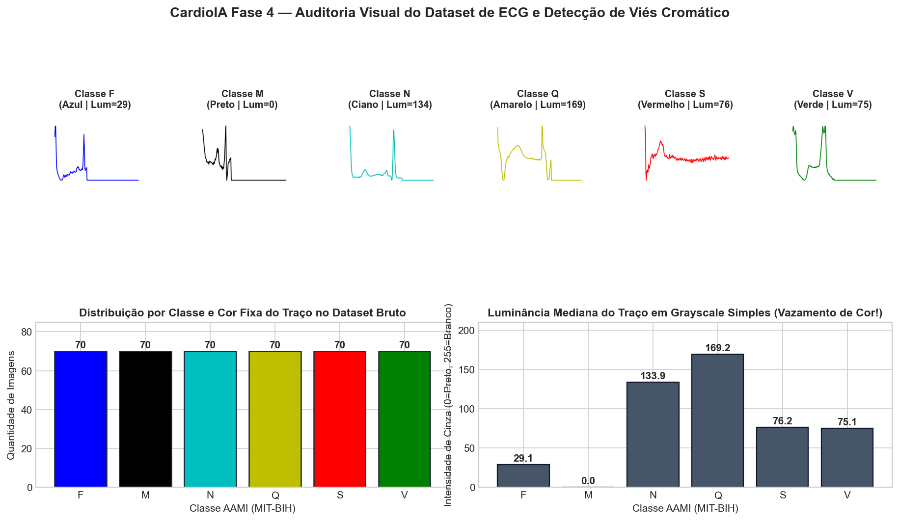
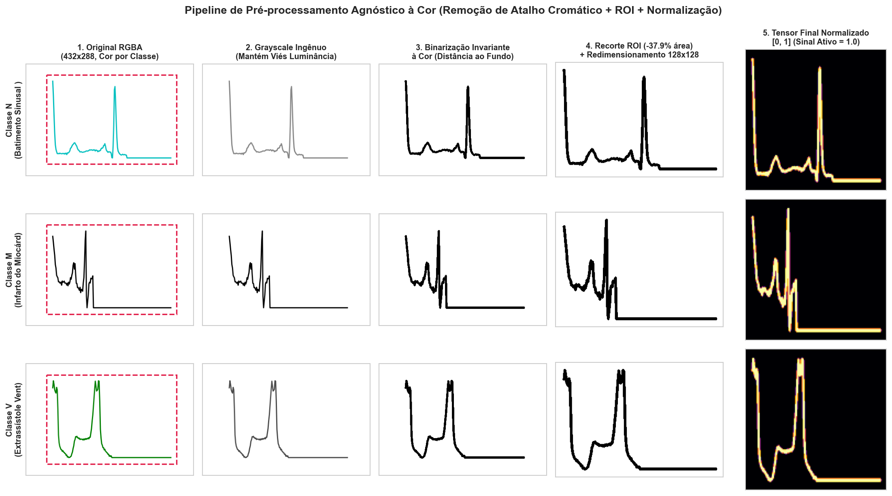
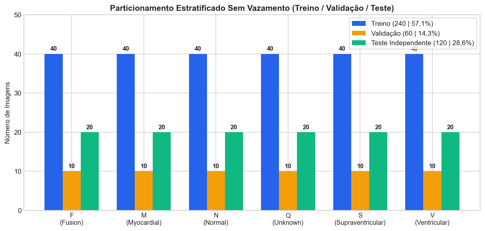

# Relatório Técnico — Parte 1: Pré-processamento e Organização de Imagens Médicas (ECG)

**Projeto:** CardioIA — A Nova Era da Cardiologia Inteligente (Fase 4: Assistente Cardiológico Virtual com Visão Computacional)  
**Aluno:** Cauã Santos — **RM:** 566599  
**Curso:** Inteligência Artificial — FIAP (2º Ano)  
**Notebook Executável (Google Colab / Jupyter):** [`Fase4/notebooks/01_preprocessamento_ecg.ipynb`](../notebooks/01_preprocessamento_ecg.ipynb)  
**Módulo Reutilizável:** [`Fase4/src/preprocessamento.py`](../src/preprocessamento.py)

---

## 1. Seleção e Auditoria do Dataset Público

Em continuidade direta à jornada construída nas Fases 1 e 2 do **CardioIA**, selecionamos o conjunto público **ECG Image Data (padrão internacional AAMI / MIT-BIH Arrhythmia)**, organizado em `Fase1/assets/images/ECG_Image_data/`. O conjunto contém **420 imagens reais** de batimentos eletrocardiográficos distribuídas em **6 classes clínicas**:

| Classe | Denominação AAMI / Clínica | Nível de Risco | Amostras | Cor Original no Dataset | Luminância em Grayscale Simples |
| :---: | :--- | :---: | :---: | :---: | :---: |
| **`N`** | Batimento Sinusal Normal (*Normal Beat*) | Baixo | 70 | Ciano `RGB(0, 191, 191)` | **133,9** |
| **`S`** | Extrassístole Supraventricular | Moderado | 70 | Vermelho `RGB(255, 0, 0)` | **76,2** |
| **`V`** | Extrassístole Ventricular (*PVC*) | Alto | 70 | Verde `RGB(0, 128, 0)` | **75,1** |
| **`F`** | Batimento de Fusão Ventricular | Alto | 70 | Azul `RGB(0, 0, 255)` | **29,1** |
| **`M`** | Infarto do Miocárdio / Alteração Isquêmica | **Crítico** | 70 | Preto `RGB(0, 0, 0)` | **0,0** |
| **`Q`** | Marca-passo ou Inclassificável | Moderado | 70 | Amarelo `RGB(191, 191, 0)` | **169,2** |

### 1.1. Auditoria de Integridade e Achado Crítico de Viés Cromático
A auditoria automatizada (`auditar_e_organizar_dataset()`) revelou dois pontos fundamentais:
1. **Integridade estrutural perfeita:** todas as 420 imagens possuem resolução uniforme `432×288` píxeis, formato `PNG` em 4 canais (`RGBA`), **420 hashes MD5 distintos (zero duplicatas)** e **zero sobreposição** entre os diretórios originais `train/` e `test/`.
2. **Viés de Atalho Cromático (*Shortcut Learning / Efeito Clever Hans*):** como evidenciado na tabela acima e na Figura 1, cada classe do dataset original foi renderizada com uma **cor fixa exclusiva**. Mesmo uma conversão ingênua para escala de cinza (`PIL.convert("L")`) mantém níveis de luminância drasticamente diferentes por classe (variando de `0,0` no Infarto até `169,2` na classe `Q`). Treinar uma CNN diretamente sobre essas imagens em RGB ou grayscale simples induziria o modelo a decorar a cor/brilho da linha em vez da morfologia cardíaca real (complexo QRS, ondas P/T e segmento ST), levando a colapso clínico em exames reais.

---

## 2. Pipeline de Pré-processamento e Justificativa Técnica das Escolhas

Para garantir que as Redes Neurais Convolucionais aprendam exclusivamente padrões morfológicos reais do ECG, projetamos um pipeline determinístico em **5 etapas**:

1. **Conversão de Formato (`RGBA` → `RGB` sobre fundo branco):** elimina o canal de transparência alfa por composição (`alpha_composite`) sobre `(255, 255, 255)`, prevenindo artefatos escuros ao converter para tensores numéricos.
2. **Binarização Agnóstica à Cor (*Color-Invariant Masking*):** em vez da luminância tradicional ($0{,}299R + 0{,}587G + 0{,}114B$), estimamos a cor de fundo $\vec{bg}$ (percentil 95 por canal) e calculamos a distância cromática máxima abaixo do fundo em qualquer canal RGB:
   $$d(x, y) = \max_{c \in \{R,G,B\}} \max(0, bg_c - I_c(x, y))$$
   Após normalizar $d$ pelo percentil 95 dos pixels de tinta, aplicamos binarização estrita ($\ge 0{,}18$) e dilatação morfológica de 1 pixel para preservar a continuidade do traço. **Justificativa:** elimina **100% da informação de matiz e luminância**, tornando qualquer cor de linha fisicamente indistinguível para a CNN (verificado experimentalmente no Ir Além 1).
3. **Recorte de Região de Interesse (ROI):** a inspeção de *bounding boxes* mostrou que os traçados ocupam `x ∈ [67, 375]` e `y ∈ [42, 243]` em `432×288`. Aplicamos o recorte padronizado `(52, 28, 388, 258)`, removendo **37,9% de margens brancas improdutivas** enquanto preservamos integralmente a posição temporal relativa e o *zero-padding* fisiológico dos batimentos (com *auto-crop* adaptativo para imagens externas enviadas no app mobile).
4. **Redimensionamento Padronizado por Arquitetura:**
   * **`128×128` píxeis (1 canal)** para a **CardioCNN (do zero)** — dobra a resolução espacial frente ao MLP de `64×64` da Fase 2, preservando detalhes finos de onda P, pico R e depressão/elevação de ST com baixo custo computacional;
   * **`224×224` píxeis (3 canais replicados)** para **Transfer Learning (ResNet18)** — compatibilidade nativa com os campos receptivos pré-treinados no ImageNet-1K.
5. **Normalização de Intensidade:**
   * **CNN do zero:** intervalo $[0, 1]$ com inversão de polaridade (**sinal elétrico = `1,0`**, fundo = `0,0`), de modo que filtros convolucionais e *MaxPooling* respondam diretamente à presença do traçado e não ao fundo branco;
   * **Transfer Learning:** traço escuro sobre fundo branco normalizado pelas estatísticas ImageNet ($\mu = [0{,}485, 0{,}456, 0{,}406]$, $\sigma = [0{,}229, 0{,}224, 0{,}225]$).

---

## 3. Organização em Treino, Validação e Teste e Data Augmentation Clínico

O particionamento foi executado com **estratificação rigorosa por classe** e **zero vazamento** (manifesto auditável salvo em [`Fase4/data/processed/manifest_dataset.csv`](../data/processed/manifest_dataset.csv)):

| Conjunto | Imagens | Por Classe | Proporção | Papel no Pipeline |
| :--- | :---: | :---: | :---: | :--- |
| **Treino (`train`)** | 240 | 40 | 57,1% | Ajuste dos pesos convolucionais com *Data Augmentation* online |
| **Validação (`val`)** | 60 | 10 | 14,3% | Monitoramento de *overfitting*, ajuste de taxa de aprendizado e seleção do melhor checkpoint |
| **Teste (`test`)** | 120 | 20 | 28,6% | Avaliação final independente (diretório `test/` original preservado intacto) |

### Data Augmentation Clinicamente Seguro
Para ampliar a generalização em um conjunto de 240 imagens de treino sem corromper o significado médico, aplicamos apenas transformações fisiologicamente válidas: **pequenos deslocamentos horizontais ($\pm 5\%$) e verticais ($\pm 4\%$)**, **variação de ganho/contraste ($0{,}85\times$ a $1{,}15\times$)** e **ruído gaussiano sutil ($\sigma \in [0{,}01, 0{,}035]$)**. **Excluímos deliberadamente *flips* horizontais e verticais**, pois espelhar horizontalmente inverteria a ordem temporal P→QRS→T e espelhar verticalmente transformaria um supradesnivelamento isquêmico de ST em infradesnivelamento — erro grave em cardiologia.
