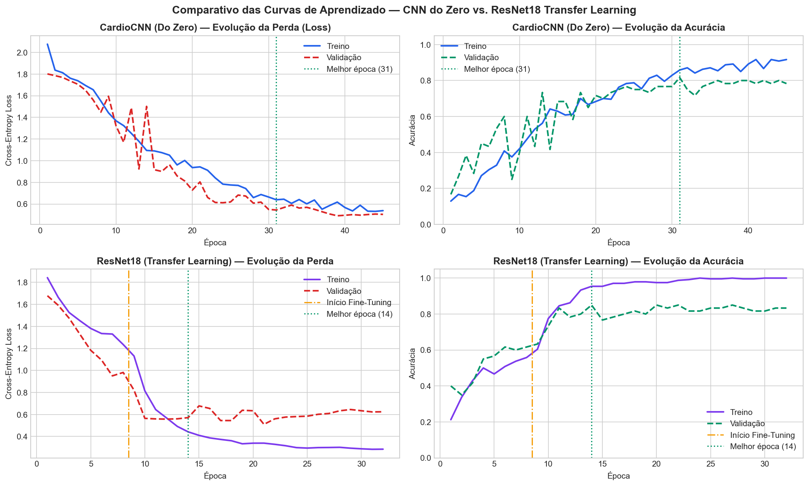
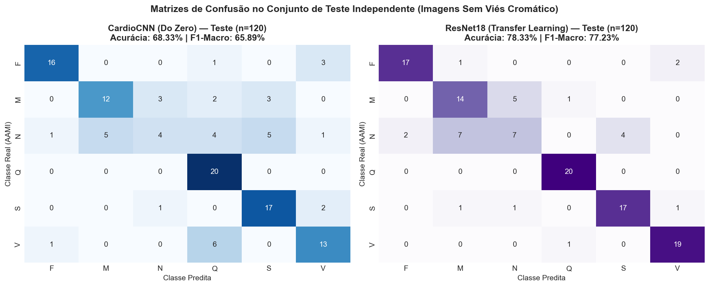
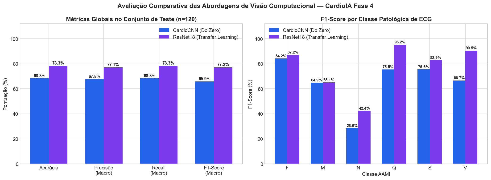
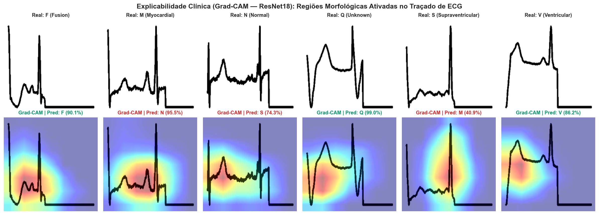

# Relatório Técnico — Parte 2: Classificação de Imagens Médicas (ECG) com CNN do Zero e Transfer Learning

**Projeto:** CardioIA — A Nova Era da Cardiologia Inteligente (Fase 4: Assistente Cardiológico Virtual com Visão Computacional)  
**Aluno:** Cauã Santos — **RM:** 566599  
**Notebook Executável (Google Colab / Jupyter):** [`Fase4/notebooks/02_classificacao_cnn_transfer_learning.ipynb`](../notebooks/02_classificacao_cnn_transfer_learning.ipynb)  
**Código-Fonte:** [`Fase4/src/modelos.py`](../src/modelos.py) | [`Fase4/src/treinar_e_avaliar.py`](../src/treinar_e_avaliar.py)  
**Protótipo Web Flask:** [`Fase4/backend/app.py`](../backend/app.py)

---

## 1. Arquiteturas Implementadas e Estratégia de Treinamento

Todas as imagens foram submetidas ao pipeline **Color-Invariant** da Parte 1 (eliminando 100% do viés cromático), forçando ambas as arquiteturas a aprenderem exclusivamente a **morfologia eletrocardiográfica real** sobre **240 imagens de treino** (40 por classe), **60 de validação** e **120 de teste independente** (20 por classe):

### 1.1. Abordagem A — `CardioCNN` (CNN Treinada do Zero)
* **Entrada:** Tensor `(1, 128, 128)` normalizado em $[0, 1]$ (sinal ativo = `1,0`, fundo = `0,0`).
* **Topologia (455.270 parâmetros):** 4 blocos convolucionais progressivos (`Conv2d -> BatchNorm2d -> ReLU -> MaxPool2d`) com `32 -> 64 -> 128 -> 256` filtros, seguidos por **Dual Global Pooling** (`AdaptiveAvgPool2d + AdaptiveMaxPool2d` = 512 atributos, capturando tanto a energia global da linha de base quanto a amplitude máxima do pico R/QRS) e classificador denso regularizado (`Dropout(0.35) -> Linear(512, 128) -> ReLU -> Dropout(0.245) -> Linear(128, 6)`).
* **Treinamento:** 45 épocas, otimizador `AdamW` ($\text{lr}=1{,}2\times 10^{-3}$, `weight_decay=1e-3`), *Cross-Entropy* com `label_smoothing=0.05`, agendador `CosineAnnealingLR` e seleção do melhor checkpoint pela combinação de F1-Macro e *loss* em validação (melhor época: **31**).

### 1.2. Abordagem B — `ResNet18` (Transfer Learning — ImageNet-1K)
* **Entrada:** Tensor `(3, 224, 224)` com traço binarizado padronizado pelos momentos ImageNet.
* **Topologia (11.242.950 parâmetros):** Backbone `ResNet18` pré-treinado no ImageNet-1K com cabeça classificadora substituída por `Dropout(0.35) -> Linear(512, 128) -> ReLU -> Dropout(0.21) -> Linear(128, 6)`.
* **Treinamento em 2 Estágios:**
  1. **Estágio 1 — *Feature Extraction* (8 épocas):** backbone congelado (`requires_grad=False`), treinando apenas a nova cabeça classificadora ($\text{lr}=1{,}5\times 10^{-3}$).
  2. **Estágio 2 — *Fine-Tuning* (24 épocas):** desbloqueio seletivo dos blocos `layer2`, `layer3`, `layer4` e `fc` com **taxas de aprendizado diferenciais** ($1{,}5\times 10^{-4}$ no backbone; $6{,}0\times 10^{-4}$ na cabeça) e `CosineAnnealingLR` (melhor época: **14**, atingindo **85,0% de acurácia em validação**).

---

## 2. Resultados Quantitativos no Conjunto de Teste Independente (n = 120)

| Modelo / Abordagem | Parâmetros | Validação (Acc / F1) | Teste Acurácia | Teste Precisão (Macro) | Teste Recall (Macro) | Teste F1-Score (Macro) |
| :--- | :---: | :---: | :---: | :---: | :---: | :---: |
| **CardioCNN (Treinada do Zero)** | 455.270 | 81,67% / 81,52% | **68,33%** | 67,75% | 68,33% | **65,89%** |
| **ResNet18 (Transfer Learning)** | 11.242.950 | **85,00% / 84,83%** | **78,33%** | **77,07%** | **78,33%** | **77,23%** |
| **Ganho do Transfer Learning** | — | +3,33 pp / +3,31 pp | **+10,00 pp** | **+9,32 pp** | **+10,00 pp** | **+11,34 pp** |

### 2.1. Desempenho Detalhado por Classe AAMI (Conjunto de Teste — 20 imagens/classe)

| Classe AAMI | CardioCNN — Prec / Rec / F1 | ResNet18 Transfer — Prec / Rec / F1 | Leitura Clínica |
| :---: | :---: | :---: | :--- |
| **`Q` (Marca-passo / Desc.)** | 60,6% / 100,0% / 75,5% | **90,9% / 100,0% / 95,2%** | Separação morfológica quase perfeita (20/20 acertos na ResNet18). |
| **`V` (Extrassístole Ventricular)** | 68,4% / 65,0% / 66,7% | **86,4% / 95,0% / 90,5%** | **+30 pp de ganho em Recall** em uma arritmia de **alto risco** (19/20 detectados). |
| **`F` (Fusão Ventricular)** | 88,9% / 80,0% / 84,2% | **89,5% / 85,0% / 87,2%** | Alta especificidade e sensibilidade na distinção de batimentos híbridos. |
| **`S` (Supraventricular)** | 68,0% / 85,0% / 75,6% | **81,0% / 85,0% / 82,9%** | Excelente equilíbrio entre precisão e sensibilidade. |
| **`M` (Infarto do Miocárdio)** | 70,6% / 60,0% / 64,9% | **60,9% / 70,0% / 65,1%** | Ganho de +10 pp em Recall com ResNet18; confusão concentrada com `N`. |
| **`N` (Batimento Normal)** | 50,0% / 20,0% / 28,6% | **53,8% / 35,0% / 42,4%** | Principal fronteira de erro com `M` (7 casos) e `S` (4 casos). |

### 2.2. Análise Crítica dos Resultados e Explicabilidade (Grad-CAM)
1. **Superioridade comprovada do Transfer Learning em regime de poucos dados médicos:** com apenas 40 exames por classe no treino, os filtros pré-treinados de bordas, curvaturas e texturas da `ResNet18` transferiram-se eficazmente para a geometria dos traçados de ECG, superando a CNN do zero em **+10,0 pp de acurácia** e **+11,34 pp de F1-Macro**.
2. **Interpretação clínica da fronteira `N` ↔ `M`:** a análise da matriz de confusão e dos mapas de calor **Grad-CAM** (Figura abaixo) revela que os principais erros ocorrem entre batimentos normais (`N`) e isquêmicos (`M`) — exatamente o ponto fisiologicamente mais desafiador quando se observa apenas **um único batimento isolado em 1 derivação**, sem contexto de frequência cardíaca ou ECG completo de 12 derivações. Essa constatação fundamenta diretamente a calibração de limiar conservador estudada no **Ir Além 1**.

---

## 3. Protótipo de Apresentação dos Resultados (Flask + App Mobile)

Os modelos treinados (`Fase4/models/resnet18_transfer_ecg.pt` e `cnn_scratch_ecg.pt`) foram encapsulados no motor `CardioPredictor` e expostos em duas interfaces complementares:
1. **Interface Web Interativa em Flask (`Fase4/backend/app.py` → `http://127.0.0.1:5000`):** permite *drag-and-drop* de exames de ECG ou teste com 1 clique sobre amostras reais do conjunto de teste, exibindo categoria AAMI, nível de risco, confiança, distribuição de probabilidades das 6 classes, entrada binarizada, mapa **Grad-CAM**, recomendação clínica simulada e histórico em SQLite.
2. **Aplicativo Mobile em React Native (`Fase4/mobile/` — Ir Além 2):** consome a mesma API REST Flask (`/api/v1/predict`), levando a análise visual de ECG para dispositivos Android/iOS/Web.
