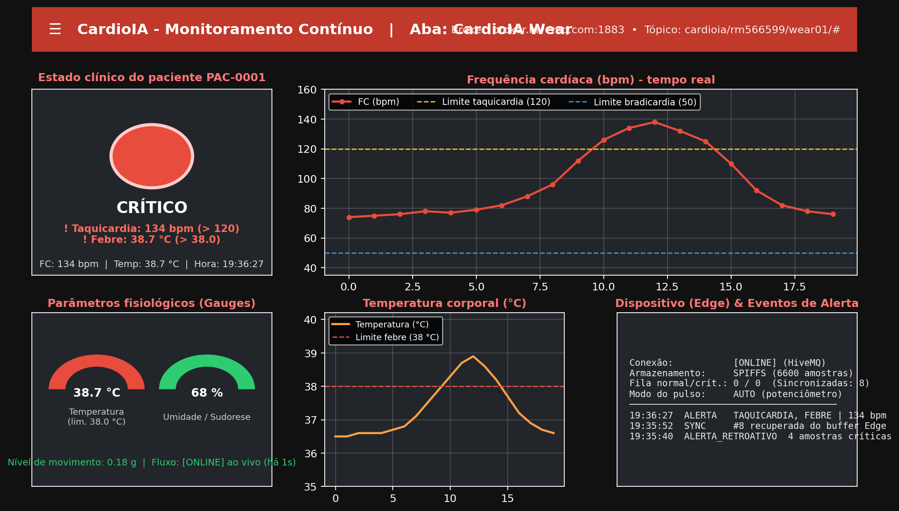
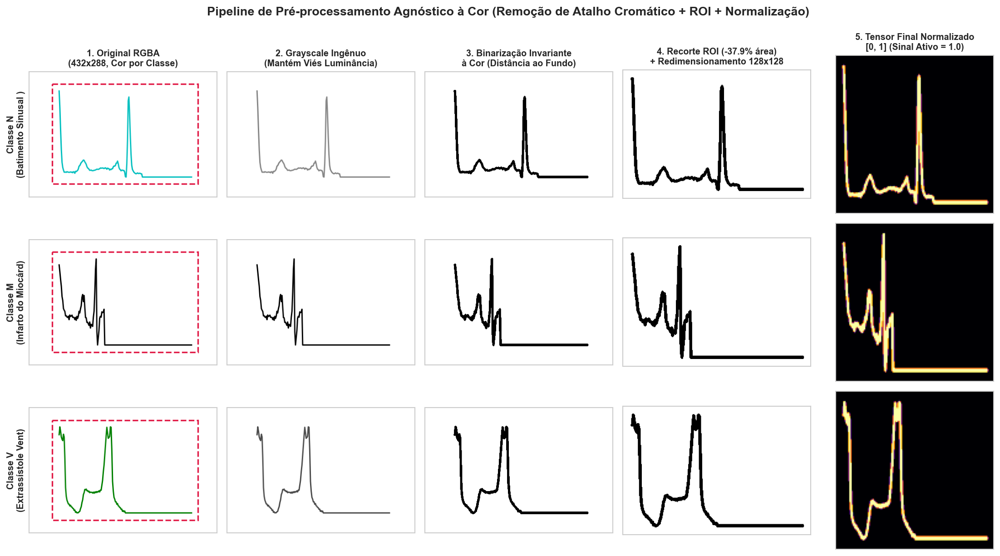
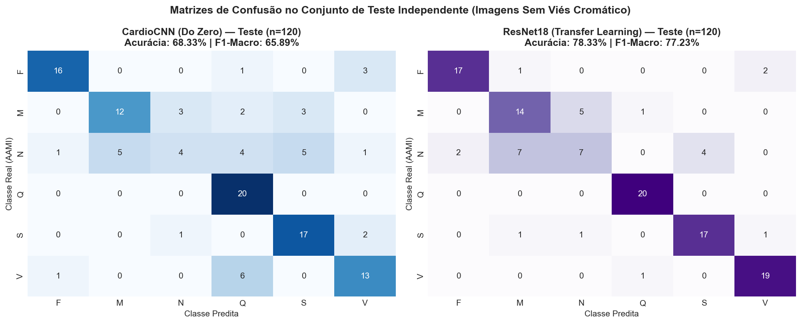
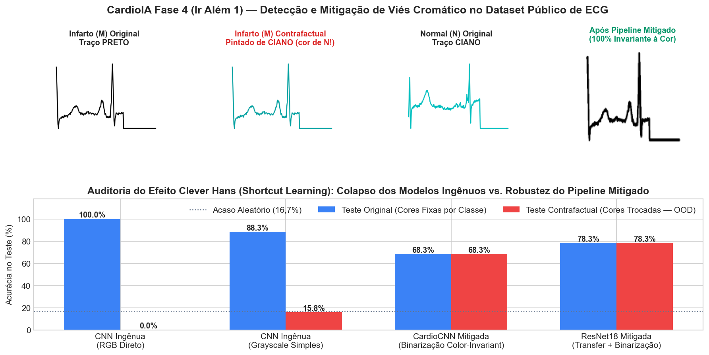

# FIAP - Faculdade de Informática e Administração Paulista

<p align="center">
  <a href="https://www.fiap.com.br/">
    
  </a>
</p>

<br>

# CardioIA: A Nova Era da Cardiologia Inteligente

> **Fase 4 - Assistente Cardiológico Virtual com Visão Computacional (CNNs, Transfer Learning, Fairness & Mobile)**  
> **Curso:** Inteligência Artificial (PBL - Project Based Learning)  
> **Instituição:** FIAP (Faculdade de Informática e Administração Paulista)

---

## 👥 Integrantes
* **Aluno:** [Cauã Santos](https://www.linkedin.com/in/cauasantoslt) — **RM:** 566599

### 👩‍🏫 Professores
* **Tutor(a):** [Leonardo Ruiz Orabona](https://www.linkedin.com/in/leonardoorabona/)
* **Coordenador(a):** [André Godoi](https://www.linkedin.com/in/andregodoichiovato/)

---

## 🔗 Acesso aos Dados (Armazenamento em Nuvem)

Todos os dados coletados e preparados para esta fase (tabelas numéricas, corpus textual para NLP e banco de imagens de ECG) estão disponíveis no link público abaixo:

<div align="center">

[-4285F4?style=for-the-badge&logo=googledrive&logoColor=white)](https://drive.google.com/drive/folders/1zWeh3gKtj51HhFHUD_G8GjBWjF0ZIVlX?usp=sharing)

**Link direto:** [https://drive.google.com/drive/folders/1zWeh3gKtj51HhFHUD_G8GjBWjF0ZIVlX?usp=sharing](https://drive.google.com/drive/folders/1zWeh3gKtj51HhFHUD_G8GjBWjF0ZIVlX?usp=sharing)

</div>

---

## 📜 1. Descrição do Projeto

O **CardioIA** é uma plataforma digital concebida para simular o ecossistema de uma cardiologia moderna e inteligente, integrando **Ciência de Dados**, **Machine Learning**, **Processamento de Linguagem Natural (NLP)**, **Visão Computacional** e **IoT**. 

Na **Fase 1 (Batimentos de Dados)**, atuamos na base do ecossistema hospitalar: levantamento, organização, curadoria clínica e governança dos dados que alimentarão os futuros modelos diagnósticos, preditivos e assistentes virtuais da plataforma.

---

## 📊 2. Parte 1 – Dados Numéricos (IoT / Clínico)

### 2.1. Origem e Composição da Base
* **Dados Reais (`heart_disease_original.csv`):** 303 registros clínicos provenientes do *UCI Machine Learning Repository / Cleveland Clinic Foundation*, padrão de referência em pesquisas cardiovasculares.
* **Dados Processados e Aumentados (`cardioia_dataset_processado.csv`):** Base expandida para **504 registros**, combinando os dados reais higienizados com dados sintéticos supervisionados (preservando correlações fisiológicas). A coluna `data_origin` identifica a procedência de cada registro (`real` ou `synthetic`).
* **Formatos:** `.csv` e `.xlsx`.

### 2.2. Dicionário de Variáveis Clínicas

| Variável | Nome Padronizado | Tipo | Domínio / Unidade | Relevância Clínica & Importância para IA |
| :--- | :--- | :--- | :--- | :--- |
| `age` | `age` | Contínuo | Anos | Fator de risco não modificável primário para aterosclerose e rigidez arterial. |
| `sex` | `sex` | Binário | 1 = Masc; 0 = Fem | Epidemiologia e apresentação clínica (mulheres frequentemente manifestam sintomas atípicos). |
| `cp` | `chest_pain_type` | Categórico | 1: Típica, 2: Atípica, 3: Não-anginosa, 4: Assintomático | Variável central na triagem de emergência para estratificação de risco de isquemia miocárdica. |
| `trestbps` | `resting_bp` | Contínuo | mmHg | Pressão arterial sistólica em repouso. Hipertensão crônica gera sobrecarga e hipertrofia ventricular. |
| `chol` | `cholesterol` | Contínuo | mg/dl | Colesterol sérico total. Marcador de formação e instabilização de placas ateromatosas coronárias. |
| `fbs` | `fasting_blood_sugar` | Binário | 1 = >120 mg/dl; 0 = Normal | Glicemia de jejum elevada. Indicativo de diabetes, comorbidade de alto risco cardiovascular. |
| `restecg` | `rest_ecg` | Categórico | 0: Normal, 1: ST-T anormal, 2: Hipertrofia VE | Eletrocardiograma basal. Detecta alterações elétricas de sobrecarga e repolarização. |
| `thalach` | `max_heart_rate` | Contínuo | bpm | Frequência cardíaca máxima atingida em esforço. Reflete a reserva cronotrópica funcional. |
| `exang` | `exercise_angina` | Binário | 1 = Sim; 0 = Não | Angina induzida por esforço. Indicador direto de insuficiência de fluxo coronário. |
| `oldpeak` | `st_depression` | Contínuo | mm | Depressão do segmento ST induzida pelo esforço. Forte marcador de isquemia subendocárdica. |
| `slope` | `st_slope` | Categórico | 1: Ascendente, 2: Plano, 3: Descendente | Morfologia do ST no pico do esforço. Declives planos e descendentes indicam alto risco isquêmico. |
| `ca` | `num_major_vessels` | Discreto | 0 a 3 | Número de grandes vasos coronários com obstrução visualizados por fluoroscopia/angiografia. |
| `thal` | `thalassemia` | Categórico | 3: Normal, 6: Defeito Fixo, 7: Defeito Reversível | Cintilografia miocárdica. Diferencia miocárdio infartado fibrótico de tecido isquêmico viável. |
| `target` | `target` | Binário | 0: Ausente, 1: Presente | Desfecho clínico (presença de estenose coronariana significativa > 50%). |
| `data_origin` | `data_origin` | Texto | `real` / `synthetic` | Rastreabilidade da proveniência da linha para conformidade e governança. |

### 2.3. Governança, LGPD e Mitigação de Viés
* **Privacidade:** A base é integralmente anonimizada, sem identificadores diretos (PII), respeitando os preceitos da LGPD (Lei 13.709/2018).
* **Viés Amostral:** Identificamos as distribuições por sexo e faixa etária para aplicar técnicas de balanceamento (ex: pesos balanceados de classes) nas fases de treinamento supervisionado, prevenindo subdiagnósticos em populações sub-representadas.
* **Integração com IoT:** Variáveis como pressão, frequência cardíaca e ECG de repouso simulam dados coletados por sensores em tempo real (como microcontroladores ESP32 em fases futuras).

---

## 📝 3. Parte 2 – Dados Textuais (NLP)

### 3.1. Corpus Médico na Pasta `Fase1/assets/docs/`
1. **`01_diretriz_insuficiencia_cardiaca_sus.txt`** (Fonte: Ministério da Saúde / CONITEC / SBC): Critérios diagnósticos de Framingham, estadiamento funcional NYHA e protocolo terapêutico no SUS.
2. **`02_protocolo_sindrome_coronariana_aguda_scielo.txt`** (Fonte: SciELO / SBC): Manejo de emergência no Infarto Agudo do Miocárdio (IAMCSST e IAMSSST), tempo porta-ECG e troponina.
3. **`03_manejo_arritmias_fibrilacao_atrial_bvs.txt`** (Fonte: BVS / OPAS / SOBRAC): Diagnóstico de Fibrilação Atrial, identificação de ondas *f* e estratificação de risco de AVC pelo escore $CHA_2DS_2\text{-VASc}$.
4. **`04_hipertensao_arterial_saude_populacional_sus.txt`** (Fonte: Fiocruz / MS): Epidemiologia da HAS, lesões em órgãos-alvo e estratégias de adesão terapêutica na atenção primária.

### 3.2. Exploração por Processamento de Linguagem Natural (NLP)
* **Named Entity Recognition (NER Clínico):** Treinamento de modelos para identificar automaticamente sintomas (*"dispneia paroxística"*, *"dor precordial"*), medicações (*"Enalapril"*, *"Metoprolol"*) e escores de gravidade em prontuários e relatos livres.
* **Classificação de Tópicos e Triagem de Urgência:** Classificação automática de queixas de pacientes para priorizar emergências (SCA/IAM) frente a quadros crônicos ambulatoriais.
* **Análise de Sentimento e Adesão:** Análise do nível de ansiedade e adesão medicamentosa do paciente para o futuro assistente virtual (Fase 5).
* **RAG (Retrieval-Augmented Generation):** Uso das diretrizes oficiais como base vetorial de conhecimento confiável para alimentar chatbots médicos sem alucinações.

---

## 🖼️ 4. Parte 3 – Dados Visuais (Visão Computacional)

### 4.1. Conjunto de Imagens de ECG
Reunimos mais de 100 imagens de exames de Eletrocardiograma (ECG) organizadas na pasta `Fase1/assets/images/ECG_Image_data/`, estruturadas nos padrões internacionais da **AAMI / MIT-BIH**:

* **`N` (Normal Beat):** Batimentos sinusais normais (ritmo fisiológico de referência).
* **`S` (Supraventricular Ectopic Beat):** Extrassístoles supraventriculares (gatilhos para taquiarritmias e Fibrilação Atrial).
* **`V` (Ventricular Ectopic Beat):** Extrassístoles ventriculares (alerta para taquicardia/fibrilação ventricular).
* **`F` (Fusion Beat):** Batimentos de fusão ventricular (focos elétricos simultâneos).
* **`Q` (Unknown / Paced Beat):** Batimentos inclassificáveis ou originados por marca-passo.
* **`M` (Myocardial Infarction / Pathological):** Traçados com elevação de segmento ST e padrões isquêmicos agudos.

### 4.2. Exploração por Visão Computacional (VC)
* **Detecção de Padrões e Morfologia:** Algoritmos de filtragem e detecção de bordas para segmentar complexos **QRS**, medir intervalos **PR**, **QT** e desníveis do segmento **ST**.
* **Classificação com Redes Convolucionais (CNNs):** Treinamento de redes neurais (ex: ResNet, EfficientNet) para diagnóstico automatizado das classes de arritmia a partir da imagem do traçado.
* **Explicabilidade (Grad-CAM):** Geração de mapas de calor visuais destacando no traçado exatamente qual onda levou o modelo à predição diagnóstica, garantindo transparência e confiabilidade clínica.

---

## 🩺 5. Fase 2 – Diagnóstico Automatizado: IA no Estetoscópio Digital

Nesta fase, implementamos os módulos de automação diagnóstica e suporte à decisão médica, unindo **Processamento de Linguagem Natural (NLP)**, **Machine Learning Supervisionado**, **Visão Computacional com Redes Neurais** e um **Portal Web Interativo**:

### 5.1. Parte 1 – Extração de Sintomas e Mapeamento Ontológico de Doenças
* **Entrada Textual (`Fase2/data/frases_sintomas.txt`):** 10 relatos clínicos ricos descrevendo o que o paciente sente, quando os sintomas iniciaram e como afetam suas atividades diárias.
* **Mapa de Conhecimento (`Fase2/data/mapa_conhecimento.csv`):** Ontologia médica relacionando pares de sintomas (*Sintoma 1 | Sintoma 2*) às patologias correspondentes (*Síndrome Coronariana Aguda/IAM*, *Insuficiência Cardíaca*, *Fibrilação Atrial*, *Hipotensão/Pré-Síncope*, etc.).
* **Pipeline de Extração (`Fase2/src/extracao_diagnostico.py`):** Algoritmo de normalização Unicode (remoção de acentos e conversão para caixa baixa), busca léxica por entidades clínicas e inferência diagnóstica estruturada.

### 5.2. Parte 2 – Classificador de Triagem Textual (TF-IDF + Machine Learning)
* **Dataset de Triagem (`Fase2/data/triagem_risco.csv`):** 32 relatos médicos balanceados (16 de *alto risco* e 16 de *baixo risco*) simulando o Protocolo de Manchester para priorização de atendimento emergencial.
* **Vetorização Numérica:** Algoritmo **TF-IDF** (Term Frequency - Inverse Document Frequency) configurado com unigramas e bigramas (`ngram_range=(1, 2)`) e stop-words médicas em português.
* **Modelo Preditivo:** Regressão Logística com regularização L2, alcançando **100% de Acurácia** e **100% de Recall** para a classe crítica de alto risco no conjunto de teste.
* **Scripts e Notebook:**
  * Script standalone: `Fase2/src/classificador_risco.py`
  * Notebook unificado: `Fase2/notebooks/classificador_risco.ipynb` (com matriz de confusão gráfica, explicabilidade léxica e inferência em tempo real com probabilidades).

### 5.3. Ir Além 1 – Portal Web CardioIA (`cardioia-portal/`)
Aplicação web responsiva construída em **React 19 + Vite** com:
* **Autenticação Simulada (Context API):** Gerenciamento de sessão e persistência de token JWT falso em `localStorage`.
* **Proteção de Rotas:** Componente `ProtectedRoute` impedindo acesso a áreas restritas sem autenticação.
* **Dashboard Clínico:** Indicadores em tempo real (Total em Triagem, Consultas Hoje, Casos Críticos, Ocupação de Leitos) e banner de alertas emergenciais.
* **Triagem de Pacientes:** 10 pacientes clínicos com sinais vitais (P.A., Frequência Cardíaca, SpO2), queixa em texto livre, filtro por nível de risco e busca instantânea.
* **Agendamento de Consultas:** Gerenciamento complexo com `useReducer` (`ADD_APPOINTMENT`, `CANCEL_APPOINTMENT`, `FILTER_BY_DOCTOR`) e controle de inputs com `useState`.
* **Estilização Modular:** CSS Modules (`*.module.css`) com design system hospitalar moderno.

### 5.4. Ir Além 2 – Diagnóstico Visual de ECG com Rede Neural MLP em Keras (`Fase2/notebooks/mlp_ecg_diagnostico.ipynb`)
Pipeline de Deep Learning para classificação binária de exames de Eletrocardiograma (Normal vs. Anormal):
* **Dataset de ECG:** Imagens da pasta `Fase1/assets/images/ECG_Image_data/` (Normal: `N`; Anormal: `M`, `V`, `S`).
* **Pré-processamento:** Redimensionamento para $64 \times 64$ píxeis em escala de cinza, normalização $[0, 1]$ e achatamento (*flatten*) para vetor de 4096 features de entrada.
* **Arquitetura Keras:** Camada Dense (256, ReLU, He Normal), BatchNormalization, Dropout(0.3), Dense (64, ReLU), Dropout(0.2) e Saída Dense (1, Sigmoid).
* **Treinamento & Monitoramento:** `EarlyStopping(patience=5)` com Adam ($\alpha = 0.001$), curvas de perda/acurácia, Matriz de Confusão, Relatório de Classificação e Curva ROC/AUC.
* **Governança:** Discussão crítica sobre limitações do MLP frente a Redes Convolucionais (CNNs da Fase 4) e assimetria clínica dos Falsos Negativos.

---

## 📡 6. Fase 3 – Monitoramento Contínuo: IoT na Saúde (Edge, Fog & Cloud)

Na **Fase 3**, expandimos o ecossistema **CardioIA** com o **CardioIA Wear**, um protótipo de dispositivo vestível (*wearable*) em **ESP32 (Wokwi)** integrado via **MQTT (HiveMQ)** a um dashboard em tempo real no **Node-RED** e a um subsistema automatizado **REST + RPA em Python**:

### 6.1. Parte 1 – Armazenamento e Processamento Local (Edge Computing)
* **Link do Projeto no Wokwi:** [**https://wokwi.com/projects/479801389695851521**](https://wokwi.com/projects/479801389695851521)
* **Circuito e Firmware ESP32 (`Fase3/esp32_wearable/`):**
  * **Sensores:** **DHT22** obrigatório (temperatura corporal °C e umidade/sudorese %), **Botão de Pressão + Potenciômetro** (frequência cardíaca em BPM, com modo manual por interrupção e modo automático com variabilidade fisiológica) e **MPU6050 I2C** (acelerômetro 3 eixos a 20 Hz para nível de atividade, detecção de queda $> 2{,}5\,g$ e imobilidade prolongada).
  * **Conectividade e Atuadores:** chave deslizante `swWifi` controlando a variável booleana `wifiSimulado` (simulando quedas de rede), chave `swModo` (`AUTO`/`MANUAL`), 3 LEDs (`ONLINE`, `OFFLINE`, `ALERTA`) e buzzer de alarme local.
  * **Resiliência Offline Alinhada ao Negócio:** capacidade dimensionada para **6.600 amostras** (~8h20 de autonomia offline em produção a 1 leitura/5 s), dividida em **duas filas independentes**: **Fila Crítica Prioritária (`600` amostras)** e **Fila Normal (`6.000` amostras)**, impedindo que leituras normais sobrescrevam alertas médicos.
  * **Duplo Backend (`SPIFFS` + `RAM`):** gravação em arquivos CSV segmentados (`/n_*.csv` e `/c_*.csv`) na Flash **SPIFFS** em chips reais, com *fallback* automático para buffer circular em **RAM** no simulador Wokwi. Ao reconectar, sincroniza primeiro os alertas críticos em lotes não-bloqueantes (`Serial.println("[SYNC->CLOUD] ...")` + publicação MQTT em `/backlog`) e apaga o arquivo/registro local após confirmação.
* **Relatório Técnico Parte 1:** [`Fase3/relatorios/Relatorio_Parte1_Edge_Computing.md`](Fase3/relatorios/Relatorio_Parte1_Edge_Computing.md)


### 6.2. Parte 2 – Transmissão para Nuvem e Visualização (Fog/Cloud Computing)
* **Arquitetura MQTT (`broker.hivemq.com:1883` / `HiveMQ Cloud TLS 8883`):**
  * Tópicos estruturados em `cardioia/rm566599/wear01/`: `/telemetria` (QoS 0), `/backlog` (QoS 0), `/alerta` (QoS 1), `/status` (QoS 1 + *Retained* + *Last Will and Testament*) e `/cmd` (QoS 1, comandos remotos `silenciar` e `status`).
* **Dashboard Interativo no Node-RED (`Fase3/node-red/cardioia_dashboard_flow.json`):**
  * Camada **Fog** que valida os pacotes e reavalia os limites clínicos ($\text{FC} > 120$ ou $< 50\text{ bpm}$, $\text{Temp} > 38{,}0$ ou $< 35{,}0\,^\circ\text{C}$, queda e imobilidade);
  * **Gráficos em tempo real (`ui_chart`)** de Frequência Cardíaca e Temperatura Corporal com linhas tracejadas dos limites clínicos;
  * **Medidores (`ui_gauge`)** de Temperatura (°C), Umidade/Sudorese (%) e Movimento ($g$);
  * **Indicador visual de alerta (`ui_template` + `ui_toast`)** com LED virtual animado (verde/amarelo/vermelho pulsante), descrição dos riscos ativos, *watchdog* de fluxo de dados, painel de resiliência do ESP32 e tabela histórica de eventos e sincronizações.
* **Relatório Técnico Parte 2:** [`Fase3/relatorios/Relatorio_Parte2_MQTT_e_Dashboard.md`](Fase3/relatorios/Relatorio_Parte2_MQTT_e_Dashboard.md)



### 6.3. Ir Além 1 – Comunicação Automatizada com REST, Risco Clínico e E-mail (RPA)
* **Servidor e Cliente REST (`Fase3/ir_alem_1/api_server.py` e `cliente_rest.py`):** API em **Flask + SQLite** autenticada via `X-API-Key` para ingestão individual/em lote (`POST /api/v1/leituras`), consulta incremental (`GET /api/v1/leituras`), consolidação por paciente (`/ultima`, `/resumo`) e auditoria de alertas (`/alertas`).
* **Motor de Risco Clínico (`Fase3/ir_alem_1/risco.py`):** avalia regras instantâneas (`TAQUICARDIA`, `BRADICARDIA`, `SEM_PULSO`, `FEBRE`, `HIPOTERMIA`, `SUSPEITA_SEPSE` por critérios SIRS, `QUEDA`) e regras de janela deslizante (`TAQUICARDIA_SUSTENTADA`, `AUSENCIA_MOVIMENTO` e `IMOBILIDADE_COM_FC_BAIXA` para suspeita de síncope).
* **Automação RPA de E-mail (`Fase3/ir_alem_1/monitor_rpa.py` e `notificador_email.py`):** consome a API continuamente, aplica *cooldown* anti-spam por código de risco e dispara e-mails **MIME Multipart (HTML + texto)** via SMTP/STARTTLS ou gravação auditável `.eml` em `Fase3/ir_alem_1/outbox/`.
* **Relatório Técnico Ir Além 1:** [`Fase3/relatorios/Relatorio_Ir_Alem_1_REST_e_RPA.md`](Fase3/relatorios/Relatorio_Ir_Alem_1_REST_e_RPA.md)

---

## 🧠 7. Fase 4 – Assistente Cardiológico Virtual com Visão Computacional

Na **Fase 4**, colocamos a **Visão Computacional com Deep Learning** no centro do **CardioIA**, construindo um pipeline completo de classificação de imagens de Eletrocardiograma (ECG — padrão internacional AAMI/MIT-BIH, 6 classes: `F`, `M`, `N`, `Q`, `S`, `V`), com **CNN treinada do zero**, **Transfer Learning (ResNet18)**, **explicabilidade visual (Grad-CAM)**, **auditoria de ética e fairness (Ir Além 1)** e **integração com aplicativo mobile em React Native + backend Flask (Ir Além 2)**.

### 7.1. Parte 1 – Pré-processamento e Organização das Imagens de ECG
* **Auditoria do Dataset (`Fase1/assets/images/ECG_Image_data/`):** 420 imagens `RGBA` (`432×288`), zero duplicatas MD5 e zero sobreposição entre treino e teste.
* **Descoberta Crítica (Viés Cromático):** no dataset bruto, cada classe possui uma cor fixa exclusiva (`F`=Azul, `M`=Preto, `N`=Ciano, `Q`=Amarelo, `S`=Vermelho, `V`=Verde), o que preserva luminâncias distintas mesmo em *grayscale* simples (`0,0` a `169,2`).
* **Pipeline Agnóstico à Cor (`Fase4/src/preprocessamento.py`):** composição `RGBA → RGB` sobre fundo branco, **binarização invariante à cor** (distância cromática máxima ao fundo + dilatação de 1 px), **recorte de ROI** (`-37,9%` de margens vazias preservando a escala temporal do QRS), redimensionamento (`128×128` para CNN do zero; `224×224` para ResNet18), normalização e *Data Augmentation* clinicamente seguro (**sem *flips* verticais/horizontais**, que inverteriam a polaridade do segmento ST e a sequência P-QRS-T).
* **Particionamento Estratificado sem Vazamento:** **Treino (`240` — 40/classe)**, **Validação (`60` — 10/classe)** e **Teste Independente (`120` — 20/classe)**.
* **Entregáveis:**
  * Notebook Google Colab / Jupyter: [`Fase4/notebooks/01_preprocessamento_ecg.ipynb`](Fase4/notebooks/01_preprocessamento_ecg.ipynb)
  * Relatório Técnico (1–2 páginas): [`Fase4/relatorios/Relatorio_Parte1_Preprocessamento.md`](Fase4/relatorios/Relatorio_Parte1_Preprocessamento.md)



### 7.2. Parte 2 – Classificação de Imagens Médicas com CNN do Zero vs. Transfer Learning (ResNet18)
Avaliação rigorosa no conjunto de teste independente (`n = 120`, 100% binarizado e livre de atalho cromático):

| Abordagem / Arquitetura | Parâmetros | Validação (Acc / F1) | Teste Acurácia | Teste Precisão | Teste Recall | Teste F1-Macro |
| :--- | :---: | :---: | :---: | :---: | :---: | :---: |
| **CardioCNN (Treinada do Zero)** | 455.270 | 81,67% / 81,52% | **68,33%** | 67,75% | 68,33% | **65,89%** |
| **ResNet18 (Transfer Learning — ImageNet)** | 11.242.950 | **85,00% / 84,83%** | **78,33%** | **77,07%** | **78,33%** | **77,23%** |

* **Ganho do Transfer Learning:** **+10,00 pp de acurácia** e **+11,34 pp de F1-Macro** sobre a CNN do zero com apenas 40 imagens/classe no treino, alcançando **100% de Recall em `Q`**, **95% em `V` (Extrassístole Ventricular)** e **85% em `F` e `S`**.
* **Explicabilidade Visual (Grad-CAM):** mapas de ativação sobre `ResNet18.layer4[-1]` destacando o foco convolucional nos complexos QRS e ondas P/T.
* **Protótipo Web Interativo em Flask (`Fase4/backend/app.py`):** interface moderna para upload de ECG, escolha entre `ResNet18` e `CardioCNN`, visualização das probabilidades das 6 classes, mapa Grad-CAM, recomendação clínica simulada e histórico em SQLite.
* **Entregáveis:**
  * Notebook Python com CNN, métricas, Grad-CAM e protótipo: [`Fase4/notebooks/02_classificacao_cnn_transfer_learning.ipynb`](Fase4/notebooks/02_classificacao_cnn_transfer_learning.ipynb)
  * Relatório Técnico e prints de métricas: [`Fase4/relatorios/Relatorio_Parte2_CNN_e_Transfer_Learning.md`](Fase4/relatorios/Relatorio_Parte2_CNN_e_Transfer_Learning.md)



### 7.3. Ir Além 1 – Ética, Vieses e Governança em Visão Computacional
* **Experimento 1 (Efeito *Clever Hans* / Teste Contrafactual *Color Swap*):** ao trocar a cor das linhas no teste (ex.: Infarto pintado de ciano), a **CNN Ingênua (RGB)** colapsou de **100,0% → 0,0% (`-100 pp`)** e a **CNN Grayscale Simples** despencou de **88,3% → 15,8% (`-72,5 pp`)**, enquanto nossos modelos com binarização *Color-Invariant* mantiveram **0,0 pp de queda** (`78,3% → 78,3%` na ResNet18).
* **Experimentos 2 e 3 (Métricas Formais de Fairness e Mitigação):** comparando subgrupos de infraestrutura (**Hospital de Referência** vs. **UBS / Wearable com Ruído**), a calibração de limiar clínico ($\tau = 0{,}30$ para classes críticas `M`, `V`, `F`) elevou a sensibilidade na UBS de **78,3% → 85,0%**, reduziu Falsos Negativos críticos em **30,8%** (`21,7% → 15,0%`), reduziu o *Equal Opportunity Gap* de **0,1000 → 0,0667** e levou o *Disparate Impact Ratio* a **1,0000**.
* **Entregáveis:**
  * Relatório Técnico (até 2 páginas): [`Fase4/relatorios/Relatorio_Ir_Alem_1_Etica_e_Governanca.md`](Fase4/relatorios/Relatorio_Ir_Alem_1_Etica_e_Governanca.md)
  * Notebook de Experimentos de Fairness: [`Fase4/notebooks/03_etica_governanca_fairness.ipynb`](Fase4/notebooks/03_etica_governanca_fairness.ipynb)



### 7.4. Ir Além 2 – Aplicativo Mobile em React Native Integrado ao Backend Flask
* **App Mobile (`Fase4/mobile/`):** desenvolvido em **React Native (Expo)** com 3 abas (**Analisar ECG**, **Amostras** e **Histórico**), upload pela **Galeria/Câmera** (`expo-image-picker`), envio `multipart/form-data` para `POST /api/v1/predict` do backend Flask, exibição clara da categoria detectada, badge de risco clínico, barras de probabilidade das 6 classes AAMI e mapa **Grad-CAM**.
* **Entregáveis:**
  * Código do App + Documentação: [`Fase4/mobile/README.md`](Fase4/mobile/README.md)
  * Relatório Técnico de Integração Mobile: [`Fase4/relatorios/Relatorio_Ir_Alem_2_App_Mobile.md`](Fase4/relatorios/Relatorio_Ir_Alem_2_App_Mobile.md)

---

## 🎥 Vídeos de Demonstração (YouTube - Não Listados)

| Fase / Entrega | Link do Vídeo | Descrição |
| :--- | :--- | :--- |
| **Fase 2: Diagnóstico Automatizado & Modelos** | [Link no YouTube (Vídeo Não Listado)](https://youtu.be/d6C0rwUkQXQ) | Apresentação em até 4 min dos scripts de extração, treino do modelo de triagem, notebook e discussão de governança. |
| **Ir Além 1: Portal Web CardioIA (React)** | [Link no YouTube (Vídeo Não Listado)](https://www.youtube.com/watch?v=SEU_LINK_AQUI) | Demonstração do portal: login, proteção de rotas, dashboard, triagem e agendamento com useReducer. |
| **Fase 4 (Ir Além 2): App Mobile React Native + Flask** | [Link no YouTube (Vídeo Não Listado)](https://youtu.be/_RzOJSBcEBI) | Demonstração (até 3 min) do upload de ECG no app React Native, inferência ResNet18/CardioCNN via Flask, Grad-CAM e histórico SQLite. |

---

## 📁 8. Estrutura de Pastas Atualizada

```bash
CardioIA/
├── Fase1/
│   ├── assets/
│   │   ├── docs/
│   │   └── images/
│   │       └── ECG_Image_data/
│   │           ├── train/ (Classes: F, M, N, Q, S, V)
│   │           └── test/
│   └── data/
│       ├── processed/
│       └── raw/
├── Fase2/
│   ├── cardioia-portal/                # Ir Além 1 (Fase 2): Portal Web (React + Vite)
│   ├── data/
│   │   ├── frases_sintomas.txt         # 10 relatos clínicos
│   │   ├── mapa_conhecimento.csv       # Ontologia clínica
│   │   └── triagem_risco.csv           # 32 frases rotuladas (alto/baixo risco)
│   ├── notebooks/
│   │   ├── classificador_risco.ipynb   # Notebook unificado (Partes 1 e 2)
│   │   └── mlp_ecg_diagnostico.ipynb   # Ir Além 2 (MLP em Keras para ECG)
│   └── src/
│       ├── extracao_diagnostico.py     # Script de extração ontológica
│       └── classificador_risco.py      # Script de treino e inferência TF-IDF
├── Fase3/                              # Fase 3: Monitoramento Contínuo - IoT na Saúde
│   ├── assets/                         # Figuras e evidências visuais (Edge e Dashboard)
│   ├── esp32_wearable/                 # Parte 1: Firmware ESP32 + Circuito Wokwi
│   │   ├── src/main.cpp                # Código C++ comentado (SPIFFS/RAM + MQTT)
│   │   ├── sketch.ino                  # Cópia .ino para Wokwi Web / Arduino IDE
│   │   ├── diagram.json                # Circuito Wokwi (ESP32, DHT22, MPU6050, botão, pot, LEDs)
│   │   ├── libraries.txt               # Bibliotecas do Wokwi Web
│   │   ├── platformio.ini              # Configuração de build PlatformIO
│   │   └── wokwi.toml                  # Integração VS Code Wokwi Simulator
│   ├── node-red/                       # Parte 2: Fog Computing & Visualização
│   │   ├── cardioia_dashboard_flow.json # Export completo do fluxo Node-RED (34 nós)
│   │   └── simulador_mqtt.py           # Publicador MQTT para testar o dashboard sem Wokwi
│   ├── ir_alem_1/                      # Ir Além 1: API REST, Risco Clínico e E-mail (RPA)
│   │   ├── api_server.py               # Servidor REST (Flask + SQLite)
│   │   ├── cliente_rest.py             # Cliente HTTP REST (requests)
│   │   ├── risco.py                    # Motor de risco (regras instantâneas e janela)
│   │   ├── notificador_email.py        # Disparo de e-mail MIME/SMTP ou outbox/*.eml
│   │   ├── monitor_rpa.py              # Robô RPA de polling e disparo com cooldown
│   │   ├── simulador_wearable.py       # Simulador de cenários + ponte MQTT -> REST
│   │   ├── demo_completa.py            # Execução e teste ponta a ponta automatizado
│   │   └── outbox/                     # E-mails .eml gerados automaticamente
│   └── relatorios/                     # Relatórios técnicos detalhados da Fase 3
│       ├── Relatorio_Parte1_Edge_Computing.md
│       ├── Relatorio_Parte2_MQTT_e_Dashboard.md
│       └── Relatorio_Ir_Alem_1_REST_e_RPA.md
├── Fase4/                              # Fase 4: Visão Computacional com CNNs, Fairness & Mobile
│   ├── assets/                         # 9 figuras científicas (pré-processamento, métricas, Grad-CAM, fairness)
│   ├── data/processed/                 # Manifesto estratificado (CSV), resumo e auditoria de fairness (JSON)
│   ├── models/                         # Pesos treinados (cnn_scratch_ecg.pt, resnet18_transfer_ecg.pt) e metadados
│   ├── notebooks/
│   │   ├── 01_preprocessamento_ecg.ipynb               # Parte 1 (Google Colab / Jupyter)
│   │   ├── 02_classificacao_cnn_transfer_learning.ipynb # Parte 2 (CNN Zero vs ResNet18 + Grad-CAM)
│   │   └── 03_etica_governanca_fairness.ipynb          # Ir Além 1 (Experimentos de Fairness)
│   ├── src/
│   │   ├── preprocessamento.py         # Pipeline Color-Invariant, ROI crop, normalização e splits
│   │   ├── modelos.py                  # CardioCNN, ResNet18ECG, GradCAM e CardioPredictor
│   │   ├── treinar_e_avaliar.py        # Treinamento completo, métricas e geração de gráficos
│   │   ├── auditoria_fairness.py       # Experimento Clever Hans (Color Swap) + métricas de fairness
│   │   └── gerar_notebooks.py          # Gerador/executor reproduzível dos 3 notebooks .ipynb
│   ├── backend/                        # Parte 2 (Protótipo Web Flask) + Ir Além 2 (API REST Mobile)
│   │   ├── app.py                      # Servidor Flask + CORS + SQLite (/api/v1/predict, /samples, /history)
│   │   ├── templates/index.html        # Protótipo Web interativo com upload, probabilidades e Grad-CAM
│   │   └── test_api.py                 # Testes automatizados ponta a ponta da API REST
│   ├── mobile/                         # Ir Além 2: Aplicativo Mobile em React Native (Expo)
│   │   ├── App.js                      # Telas de upload (Galeria/Câmera), amostras, resultado Grad-CAM e histórico
│   │   ├── src/services/api.js         # Integração HTTP multipart/JSON com o backend Flask
│   │   └── src/components/             # RiskBadge.js e ProbabilityBar.js
│   └── relatorios/
│       ├── Relatorio_Parte1_Preprocessamento.md
│       ├── Relatorio_Parte2_CNN_e_Transfer_Learning.md
│       ├── Relatorio_Ir_Alem_1_Etica_e_Governanca.md
│       └── Relatorio_Ir_Alem_2_App_Mobile.md
├── requirements.txt
├── .gitignore
└── README.md
```

---

## ⚙️ Como Executar os Módulos da Fase 4

### 1. Reexecutar Pré-processamento, Treinamento e Auditoria de Fairness (Opcional — modelos já salvos)
```bash
# Instala dependências Python
pip install -r requirements.txt

# Treina CardioCNN (do zero) + ResNet18 (Transfer Learning) e gera gráficos/pesos
python Fase4/src/treinar_e_avaliar.py

# Executa a auditoria de viés cromático (Clever Hans) e métricas de Fairness (Ir Além 1)
python Fase4/src/auditoria_fairness.py
```

### 2. Protótipo Web Interativo & Backend REST em Flask (Parte 2 e Ir Além 2)
```bash
python Fase4/backend/app.py
# Acesse o protótipo web em: http://127.0.0.1:5000
# Validação automatizada da API:
python Fase4/backend/test_api.py
```

### 3. Aplicativo Mobile em React Native (Ir Além 2)
```bash
cd Fase4/mobile
npm install
npm start
# Pressione 'w' (Web), 'a' (Emulador Android) ou escaneie o QR Code no app Expo Go
```

### 4. Notebooks (Google Colab / Jupyter)
Abra diretamente no VS Code, JupyterLab ou Google Colab:
* `Fase4/notebooks/01_preprocessamento_ecg.ipynb`
* `Fase4/notebooks/02_classificacao_cnn_transfer_learning.ipynb`
* `Fase4/notebooks/03_etica_governanca_fairness.ipynb`

---

## ⚙️ Como Executar os Módulos da Fase 3

### 1. Parte 1 – Simulação do Wearable ESP32 no Wokwi
* **Link direto no Wokwi Web:** [**https://wokwi.com/projects/479801389695851521**](https://wokwi.com/projects/479801389695851521)
* **No VS Code (extensão Wokwi):** abra a pasta `Fase3/esp32_wearable/`, pressione `F1` $\rightarrow$ **`Wokwi: Start Simulator`**.
* **Controles durante a simulação:**
  * Chave esquerda (`swWifi`): desligue para simular queda de Wi-Fi (modo **OFFLINE**, LED amarelo acende e amostras vão para as filas locais) e religue para ver a sincronização em lote no Monitor Serial (`[SYNC->CLOUD]`) e via MQTT;
  * Chave direita (`swModo`): alterna entre pulso automático (controlado pelo potenciômetro de 30 a 200 bpm) e manual (botão vermelho / tecla `P`);
  * Clique no **DHT22** para elevar a temperatura acima de `38.0 °C` ou no **MPU6050** para simular queda/imobilidade.

### 2. Parte 2 – Dashboard no Node-RED + Broker MQTT
```bash
# 1. Importe Fase3/node-red/cardioia_dashboard_flow.json no Node-RED (http://127.0.0.1:1880)
# 2. Acesse o dashboard em http://127.0.0.1:1880/ui
# 3. (Opcional) Para alimentar o dashboard sem abrir o Wokwi:
python Fase3/node-red/simulador_mqtt.py
```

### 3. Ir Além 1 – API REST, Verificação de Risco e E-mail Automatizado (RPA)
```bash
# Execução ponta a ponta em um único comando (sobe a API, envia 16 leituras, roda o RPA e gera os .eml):
python Fase3/ir_alem_1/demo_completa.py
```
Ou em terminais separados:
```bash
python Fase3/ir_alem_1/api_server.py           # Terminal 1: API REST na porta 5000
python Fase3/ir_alem_1/monitor_rpa.py          # Terminal 2: Robô RPA monitorando a API
python Fase3/ir_alem_1/simulador_wearable.py   # Terminal 3: Envia cenário clínico (ou --mqtt-bridge)
```

---

## ⚙️ Como Executar os Módulos da Fase 2

### 1. Extração Ontológica e Classificador de Triagem (CLI)
```bash
# Executar a extração baseada no mapa de conhecimento
python Fase2/src/extracao_diagnostico.py

# Treinar e testar o classificador TF-IDF de triagem
python Fase2/src/classificador_risco.py
```

### 2. Jupyter Notebooks
Abra o JupyterLab ou VS Code e execute:
* `Fase2/notebooks/classificador_risco.ipynb` (Partes 1 e 2 integradas com dados da pasta `data/`).
* `Fase2/notebooks/mlp_ecg_diagnostico.ipynb` (Ir Além 2 - Rede Neural MLP com Keras para imagens de ECG).

### 3. Portal Web CardioIA (React + Vite)
```bash
cd Fase2/cardioia-portal
npm install
npm run dev
```
Acesse em: `http://localhost:5173` (Credenciais: `medico@cardioia.com` / `cardio123`).

---

## 🗃 Histórico de Lançamentos

* **0.1.0 - 01/09/2026**
  * Entrega da **Fase 1 (Batimentos de Dados)**.
* **0.2.0 - 05/10/2026**
  * Entrega da **Fase 2 (Diagnóstico Automatizado – IA no Estetoscópio Digital)**.
  * Módulo de extração ontológica e inferência diagnóstica a partir de queixas em texto livre.
  * Classificador estatístico supervisionado com TF-IDF e Regressão Logística para triagem de risco clínico.
  * Implementação da interface web interativa do portal hospitalar em React + Vite (Ir Além 1).
  * Implementação do modelo de rede neural profunda MLP em Keras para diagnóstico visual de ECG (Ir Além 2).
* **0.3.0 - 04/11/2026**
  * Entrega da **Fase 3 (Monitoramento Contínuo – IoT na Saúde)**.
  * Protótipo de wearable em ESP32 no Wokwi com DHT22, sensor de pulso cardíaco (botão + gerador automático), acelerômetro MPU6050, triagem clínica embarcada e resiliência offline priorizada em SPIFFS/RAM (Parte 1).
  * Telemetria em tempo real via MQTT (HiveMQ) e dashboard interativo no Node-RED com validação na camada Fog, gráficos, gauges, LED virtual de alerta e controle remoto (Parte 2).
  * API REST em Python/Flask, cliente HTTP, motor de verificação de risco (instantâneo e em janela deslizante) e automação RPA de envio de e-mail em caso de alerta (Ir Além 1).
* **0.4.0 - 23/11/2026**
  * Entrega da **Fase 4 (Assistente Cardiológico Virtual com Visão Computacional)**.
  * Pipeline de pré-processamento *Color-Invariant* de ECG (remoção de viés cromático, recorte de ROI, normalização e particionamento estratificado 240/60/120) com notebook Google Colab e relatório técnico (Parte 1).
  * Treinamento e avaliação comparativa de **CardioCNN (do zero — 68,33% Acc / 65,89% F1)** vs. **ResNet18 Transfer Learning (78,33% Acc / 77,23% F1)**, explicabilidade **Grad-CAM** e protótipo web interativo em **Flask** (Parte 2).
  * Auditoria de ética, *Shortcut Learning* (*Color Swap* provando queda de `-100 pp` na CNN RGB ingênua vs. `0 pp` no pipeline mitigado) e métricas formais de **Fairness** com calibração de limiar clínico ($\tau=0{,}30$) reduzindo em `30,8%` os Falsos Negativos críticos em UBS (Ir Além 1).
  * Aplicativo mobile em **React Native (Expo)** integrado ao backend **Flask** com upload via galeria/câmera, exibição das 6 categorias AAMI, barras de probabilidade, Grad-CAM e histórico SQLite (Ir Além 2).
* **0.5.0 - Em breve**
  * *Fase 5: Assistente Cardiológico Virtual com RAG & NLP.*

---

## 📋 Licença

<p xmlns:cc="http://creativecommons.org/ns#" xmlns:dct="http://purl.org/dc/terms/"><a property="dct:title" rel="cc:attributionURL" href="https://github.com/agodoi/template">MODELO GIT FIAP</a> por <a rel="cc:attributionURL dct:creator" property="cc:attributionName" href="https://fiap.com.br">Fiap</a> está licenciado sobre <a href="http://creativecommons.org/licenses/by/4.0/?ref=chooser-v1" target="_blank" rel="license noopener noreferrer" style="display:inline-block;">Attribution 4.0 International</a>.</p>
